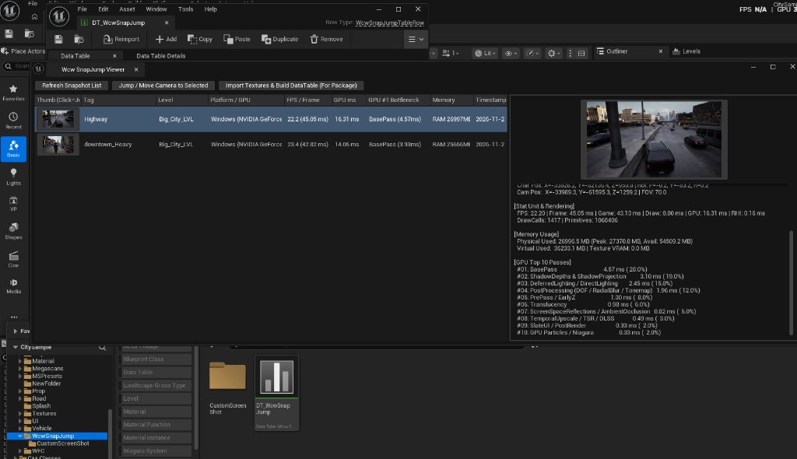

# WcwSnapJump (Beta) — Unreal Engine Visual Scene Snapshot & Instant Jump Plugin

**Version**: `0.1.0 (Beta)` | **License**: MIT License | **Supported Unreal Engine**: UE 5.6 – 5.8+

**Platforms**: Windows, PS5, Xbox Series X|S, Nintendo Switch / Switch 2 | **Created by**: WinterCrownWORKS

> **Beta Release Notice（ベータ版公開について）**
>
> 本プラグインは現在 **`v0.1.0` ベータ版**（`WcwSnapJump.uplugin` にて `"IsBetaVersion": true` 指定）として公開されています。コア機能（PNGへのメタ情報埋め込み・プラットフォーム／GPU環境情報の自動記録・Editorビューア・パッケージ用DataTable生成・コンソール実機でのコントローラー操作・タイトル側Override機構）は一通り実機検証済みですが、正式版（`v1.0.0`）に向けてフィードバックに応じたAPI・構造体フィールドやUIレイアウトの改善・変更が行われる場合があります。Issueやフィードバックを歓迎します。

`WcwSnapJump` は、プレイ中の軽量スクリーンショット（PNGファイル自体）に **座標・カレントレベル・撮影プラットフォーム＆GPU／ハードウェア環境情報・フレーム負荷（Stat / GPU Top 10 / メモリ）・タイトル固有のイベント進捗度やカットシーン再生情報** を直接バイナリ埋め込み（PNG `tEXt` チャンク）し、**Editor・PIE・コンソール実機（パッケージビルド）のすべてでサムネイル一覧表示とワンクリック／ワンボタンでのシーンジャンプ＆状態再現**を実現する Unreal Engine C++ / Blueprint プラグインです。

QAチームからのバグ報告や開発中の負荷共有において、「`Saved/WcwSnapJump/` のPNG画像1枚を受け渡すだけで、どの実機／GPU環境で撮られた負荷なのか一目で分かり、誰の環境でもその場所・そのイベント状態へ即ジャンプして再現できる」ワークフローを提供します。


## デモンストレーション動画（YouTube・UE 5.8 `CitySample` 実機収録）

| デモパート | 確認できる主な動作内容 | YouTube リンク |
| ----- | ----- | ----- |
| **1. PIE 撮影＆連続ジャンプ** (`Shot & Jump` / 29秒) | PIE実行中の `Wcw.SnapJump.Shot` 撮影と、左半分オーバーレイメニューからの連続ロケーションジャンプ | [https://www.youtube.com/watch?v=\_9tkhtKsjqI](https://www.youtube.com/watch?v=_9tkhtKsjqI) |
| **2. Editor ビューア＆パッケージ構築** (`EditorCheck` / 32秒) | `Wcw SnapJump Viewer` での負荷比較、サムネイルクリックによるEditorカメラ即移動、`DT_WcwSnapJump` 自動生成 | [https://www.youtube.com/watch?v=7EHGRMnf3EI](https://www.youtube.com/watch?v=7EHGRMnf3EI) |
| **3. パッケージ実機 撮影＆ジャンプ** (`Packaged Build` / 36秒) | パッケージ版での新規スナップショット追加撮影、事前焼き込みDataTableとの統合一覧表示、コントローラー操作での即ジャンプ | [https://www.youtube.com/watch?v=lxPwkk5PGUg](https://www.youtube.com/watch?v=lxPwkk5PGUg) |

* **オフライン閲覧用PDFマニュアル**: リポジトリ同梱の [`Doc/WcwSnapJump_Documentation_v0.1.0_Beta.pdf`](Doc/WcwSnapJump_Documentation_v0.1.0_Beta.pdf) でも全手順・図解を参照できます。

## 主な特徴（Key Features）

* **PNG単体完結のメタデータ＆撮影環境埋め込み (`FWcwSnapJumpSerializer` / `FWcwEnvironmentSnapshot`)**

  * 元画面のアスペクト比を維持した軽量PNG（既定で長辺 `512px`、16:9時は `512x288`）の `IHDR` 直後に独自 `tEXt` チャンク（`WcwSnapJump`）を埋め込みます。あわせてテキスト閲覧・外部スクリプト連携用の同名 `.json` サイドカーも対で出力できます。

  * 座標・Stat・GPU負荷に加えて、**撮影プラットフォーム（`Windows` / `PS5` / `XSX` / `Switch` 等）・実行ビルド環境（`Editor/PIE` か `Packaged` か）・使用グラフィックボード名＆ドライババージョン・CPU名・RHI（`D3D12` / `Vulkan` 等）・撮影時の実解像度**をデフォルトで自動記録します。

* **Editor専用の負荷・環境比較＆ジャンプビューア (`Wcw SnapJump Viewer`)**

  * `Window -> Wcw SnapJump Viewer` から撮影済みスナップショットを一覧表示。**Platform / GPU**・FPS・フレーム時間・GPU時間・GPUボトルネック1位・メモリ使用量を横並びで比較でき、サムネイルクリックで **Editorカメラの即移動（非PIE時）** または **ランタイムジャンプ（PIE実行中）** が走ります。

* **コンソール実機・パッケージビルド完全対応のアセット自動構築**

  * Editorビューアの **`Import Textures & Build DataTable (For Package)`** ボタン1つで、各PNGを `<DataTable配置フォルダ>/CustomScreenShot/` 配下に永続 `UTexture2D` アセット（`.uasset`）として自動インポート・ディスク物理保存し、`UDataTable` へのメタデータ焼き込み、`Config/DefaultGame.ini` の更新、`DirectoriesToAlwaysCook` への自動登録まで一括完了します。

  * パッケージ実行時は `DefaultSnapJumpDataTable` に加え、ランタイム `AssetRegistry` による自動DataTable検出フォールバックと、実機セッション中に新規撮影したスナップショットのオンメモリ即時反映（`SessionCapturedSnaps`）を備えています。

* **コンソール機のコントローラー操作に最適化したランタイムUI (`UWcwSnapJumpBrowserWidget`)**

  * ゲーム画面の右半分を隠さない「画面左半分・上下2段構成」のオーバーレイUIを採用。

  * メニュー表示中は `FInputModeUIOnly` ＋ `IInputProcessor`（最優先Index 0登録）＋毎フレームのフォーカス強制維持により、`CommonUI` 採用タイトルやデバッグコンソール閉鎖直後でも確実にコントローラー入力を捕捉します。

  * `EKeys::Virtual_Accept` / `Virtual_Gamepad_Accept`（UE 5.6以下・5.7以降自動切替）により、Switch / Switch 2（右A＝決定・下B＝キャンセル）や PS5 / Xbox / PC の各プラットフォーム規約に自動で従います。

* **タイトル側で自在にOverrideできる拡張設計 (`UWcwSnapJumpHandler`)**

  * プラグイン本体に一切手を入れることなく、C++またはBlueprintの派生クラス（あるいはSubsystemデリゲート）から **「Stat/GPU情報の差し替え」「イベント進捗やカットシーン再生秒数の記録」「UI表示テキストの整形」「タイトル独自のフェード／非同期レベルローダーへの差し替え」「ジャンプ完了後のイベント・カットシーン自動再生」** をすべてカスタマイズできます。

## デフォルトで自動記録されるメタデータ項目 (`FWcwSnapJumpData`)

PNG内の `tEXt` チャンクおよび同名 `.json` ファイルには、標準で以下の情報がシリアライズされます。

| カテゴリ | 構造体 / 主要フィールド | 記録内容の例 |
| ----- | ----- | ----- |
| **基本・識別情報** | `CaptureTag`, `TimestampIso8601`, `SourceFileName` | `"downtown_Heavy"`, `"2026-11-20T11:52:48Z"` |
| **撮影プラットフォーム＆環境** (`FWcwEnvironmentSnapshot`) | `PlatformName`, `BuildEnvironment`, `GpuAdapterName`, `GpuDriverVersion`, `CpuBrand`, `RhiName`, `ViewportResolution` | `Windows` / `PS5` / `Switch`, `Development (Editor/PIE)` / `Development (Packaged)`, `NVIDIA GeForce RTX 4060 Ti` (Driver `581.29`), `D3D12`, `1920x1080` |
| **レベル＆空間座標** | `LevelName`, `LevelPackageName`, `LoadedStreamingLevels`, `CharacterLocation` / `Rotation`, `ControlRotation`, `CameraLocation` / `Rotation` / `FOV` | 永続レベルパス、ロード済みサブレベル配列、Pawn座標・向き、カメラ座標・画角 |
| **フレーム負荷 (`stat unit`)** (`FWcwStatSnapshot`) | `FPS`, `FrameTimeMs`, `GameThreadTimeMs`, `RenderThreadTimeMs`, `GpuTimeMs`, `RhiThreadTimeMs`, `DrawCalls`, `PrimitivesDrawn` | `22.20 FPS`, Frame `45.05 ms`, GT `43.13 ms`, GPU `16.31 ms`, DrawCalls `1417` |
| **メモリ使用量** (`FWcwMemorySnapshot`) | `UsedPhysicalMemoryMB`, `PeakPhysicalMemoryMB`, `UsedVirtualMemoryMB`, `AvailablePhysicalMemoryMB` | プロセス使用物理メモリ・ピーク物理メモリ・空き物理メモリ（MB） |
| **GPU上位ボトルネック** (`TArray<FWcwGpuPassEntry>`) | `GpuTop10Passes` (`PassName`, `DurationMs`, `PercentageOfFrame`) | 上位N件（既定10件）のパス名・処理時間（ms）・フレーム占有率（%） |
| **タイトル拡張領域** | `CustomTitleTags` (`TMap<FString, FString>`), `CustomJsonPayload` (`FString`) | イベント進捗ID、カットシーンアセット＆再生秒数、独自 `USTRUCT` のJSON文字列など |

## リポジトリ・ディレクトリ構成

プロジェクトの `Plugins/WcwSnapJump/` にそのままクローンまたはZIP展開して配置できる構成です（`Doc/` 内のPDFマニュアルや説明画像はエンジンのクック対象外のため、パッケージビルドの実機ROM容量には一切影響しません）。

```text
WcwSnapJump/
├── WcwSnapJump.uplugin                 # プラグイン定義 (v0.1.0 Beta / Runtime + Editor モジュール)
├── LICENSE                             # MIT License
├── Doc/                                # PDFマニュアル・README用スクリーンショット
│   ├── WcwSnapJump_Documentation_v0.1.0_Beta.pdf
│   └── images/
├── README.md                           # リポジトリドキュメント
└── Source/
    ├── WcwSnapJump/                    # Runtime モジュール (コンソール・パッケージ同梱)
    │   ├── WcwSnapJump.Build.cs
    │   ├── Public/
    │   │   ├── WcwSnapJumpModule.h
    │   │   ├── WcwSnapJumpTypes.h          # FWcwSnapJumpData / FWcwEnvironmentSnapshot / FWcwSnapJumpTableRow 等
    │   │   ├── WcwSnapJumpSettings.h       # Project Settings (Extension -> Wcw Snap Jump)
    │   │   ├── WcwSnapJumpHandler.h        # タイトル側Override用の基底ハンドラクラス
    │   │   ├── WcwSnapJumpSerializer.h     # PNG tEXt チャンク読み書き & CRC32 処理
    │   │   ├── WcwSnapJumpSubsystem.h      # GameInstanceSubsystem / CVar / IInputProcessor 管理
    │   │   ├── WcwSnapJumpLibrary.h        # Blueprint / C++ 関数ライブラリ
    │   │   └── WcwSnapJumpBrowserWidget.h  # ランタイム選択メニューWidget
    │   └── Private/
    │       └── (*.cpp)
    └── WcwSnapJumpEditor/              # Editor 専用モジュール
        ├── WcwSnapJumpEditor.Build.cs
        ├── Public/
        │   ├── WcwSnapJumpEditorModule.h   # Nomad DockTab メニュー登録
        │   └── SWcwSnapJumpEditorPanel.h   # Editor 負荷一覧・DataTable & Texture 自動生成UI
        └── Private/
            └── (*.cpp)
```

## 導入と基本ワークフロー（Quick Start）

### 1. インストール

1. プロジェクト直下の `Plugins/` フォルダに `WcwSnapJump` を配置します（`YourProject/Plugins/WcwSnapJump/WcwSnapJump.uplugin`）。

2. プロジェクトをビルドして Unreal Editor を起動します（`Edit -> Plugins` 上では Beta 版バッジ付きで有効化されます。UE 5.6 と UE 5.7 / 5.8 の入力API差分は内部マクロで自動判別されます）。

### 2. スナップショットの撮影と出力ファイル（`.png` と `.json` のペア出力）

プレイ中（PIE・スタンドアロン・コンソール実機すべて可）に以下のコンソールコマンドまたはBlueprintノードを実行します。

* **コンソールコマンド**:

  ```text
  Wcw.SnapJump.Shot [任意のタグ名]
  ```

  *(実行例: `Wcw.SnapJump.Shot downtown_Heavy`)*

* **Blueprint / C++**:
  `UWcwSnapJumpLibrary::CaptureWcwSnap(this, TEXT("downtown_Heavy"));`

* **出力先と `.png` / `.json` ペアの役割分担**:
  `Saved/WcwSnapJump/WcwSnap_<LevelName>_<Tag>_<Timestamp>.png` および同名の `.json` が対で出力されます。

  * **`.png` ファイル（必須・単体完結）**: 軽量PNG画像の `tEXt` チャンク内に全メタデータJSONがバイナリ埋め込みされています。**Editor ビューア表示・ランタイムジャンプ・DataTable生成はすべて `.png` 1枚だけで完結**します（`.json` が無くても動作します）。
  * **`.json` サイドカー（任意・既定 `ON`）**: UEを起動せずにテキストエディタで座標・GPU負荷を閲覧したり、Python集計スクリプトや自動バグ起票ツールから直接パースするための可読JSONです（不要な場合は Project Settings の `bWriteJsonSidecar` を `false` にすると `.png` のみ出力します）。


### 3. チームメンバー間での情報共有手順（`Saved/WcwSnapJump` の受け渡し）

バグ報告や高負荷地点を他メンバーへ共有する際は、特別なエクスポート作業なしで `Saved/WcwSnapJump/` 内のファイルを受け渡すだけで再現できます。

1. **報告者（渡す側）**: 自分の `<Project>/Saved/WcwSnapJump/` 内から該当する **`.png` ファイル**（テキスト確認用に `.json` とセット、またはフォルダごとでも可）を Slack・Teams・Jira チケット等で共有します。
2. **確認者（受け取る側）**: 受け取った `.png` ファイルを、自分のローカル環境の **`<Project>/Saved/WcwSnapJump/`** フォルダへそのままコピーします。
3. **一覧への即時反映と再現ジャンプ**: Editor 上なら `Wcw SnapJump Viewer` の **`Refresh Snapshot List`**、ゲーム実行中ならランタイムメニュー右上の **`Refresh`** を押すだけで一覧に現れ、相手の撮影環境（GPU・解像度）や負荷内訳を確認しつつワンクリック／決定ボタンで同じ地点へ即ジャンプできます（`Wcw.SnapJump.JumpFile <File.png>` での直接指定も可）。

### 4. Editorでの確認とパッケージ用アセットの一括生成

1. Unreal Editor 上部メニューの **`Window -> Wcw SnapJump Viewer`** を開きます（動画デモ: [https://www.youtube.com/watch?v=7EHGRMnf3EI](https://www.youtube.com/watch?v=7EHGRMnf3EI)）。

2. `Saved/WcwSnapJump/` 内のPNGが自動スキャンされ、サムネイル画像・Tag・Level・**Platform / GPU**・FPS・GPU時間・GPUボトルネック1位・メモリ使用量が一覧表示されます。

   * **左端のサムネイル画像をクリック**（または行をダブルクリック）すると、通常Editor時は **Perspectiveカメラがその撮影アングルへ即移動** し、PIE実行中なら **そのままランタイムジャンプ** が実行されます。



3. コンソール実機や配布パッケージにスナップショット群を組み込む場合は、上部ツールバーの **`Import Textures & Build DataTable (For Package)`** をクリックします。

   * DataTable未設定時は `/Game/WcwSnapJump/DT_WcwSnapJump` が自動生成され、同階層の `CustomScreenShot/` 内に `T_WcwSnap_*.uasset` テクスチャが生成・**ディスク物理保存**されます。
   * 同時に `Config/DefaultGame.ini` への `DefaultSnapJumpDataTable` 登録と、`ProjectPackagingSettings` の `DirectoriesToAlwaysCook` へのフォルダ追加も自動で行われます。


### 5. ランタイム／コンソール実機でのメニュー操作とジャンプ

ゲーム中に以下のコマンドまたはCVarを実行すると、画面左半分にブラウザメニューが開きます（PIE動画: [https://www.youtube.com/watch?v=\_9tkhtKsjqI](https://www.youtube.com/watch?v=_9tkhtKsjqI) ／ パッケージ実機動画: [https://www.youtube.com/watch?v=lxPwkk5PGUg](https://www.youtube.com/watch?v=lxPwkk5PGUg)）。

* **メニュー開閉コマンド**: `Wcw.SnapJump.ToggleMenu`

* **メニュー表示CVar**: `r.Wcw.SnapJump.Menu 1` （`0` で非表示）


#### 操作一覧（コントローラー・キーボード・マウス対応）

| 操作アクション | コントローラー (Gamepad) | キーボード / マウス |
| ----- | ----- | ----- |
| **リスト項目の上下選択（自動スクロール追従）** | `D-Pad Up / Down` または `左スティック上下` | `↑` / `↓` キー、または行テキストをクリック |
| **5件単位の高速ページ移動** | `LB` / `RB` (`L1` / `R1` / `L` / `R`) | `PageUp` / `PageDown`（先頭 `Home` / 末尾 `End`） |
| **右下詳細レポート欄のスクロール** | `右スティック上下`（アナログ連続スクロール） | 詳細レポート上でマウスホイール |
| **選択シーンへジャンプ実行** | **決定ボタン**（Switch系: 右`A` / PS・Xbox系: 下`×`・`A`）または **上ボタン**（予備） | `Enter` / `Space`、または **サムネイル画像をクリック** |
| **メニューを閉じる** | **キャンセルボタン**（Switch系: 下`B` / PS・Xbox系: 右`○`・`B`） | `Escape`、または右上の `Close` ボタン |

## コマンド・コンソール変数・Project Settings リファレンス

### コンソールコマンド & CVar 一覧

| 名前 | 種別 / 既定値 | 説明 |
| ----- | ----- | ----- |
| `Wcw.SnapJump.Shot [Tag]` | Command | 指定タグ付きでスナップショットPNGを撮影・メタ情報を埋め込みます。 |
| `Wcw.SnapJump.ToggleMenu` | Command | ランタイムブラウザメニューの表示／非表示を切り替えます。 |
| `Wcw.SnapJump.JumpFile <File.png>` | Command | `Saved/WcwSnapJump/` 内の指定PNGファイルから直接ジャンプを実行します。 |
| `r.Wcw.SnapJump.Menu` | CVar (`0`) | `1` でランタイムメニューを表示、`0` で非表示にします。 |
| `r.Wcw.SnapJump.FontScale` | CVar (`1.0`) | ランタイムメニューの文字サイズ倍率（`0.5` ～ `3.0`）をリアルタイム変更します。 |
| `r.Wcw.SnapJump.Resolution` | CVar (`0`) | 保存PNGの長辺上限ピクセル数を上書きします（`0` の場合はProject Settingsに従う）。 |
| `r.Wcw.SnapJump.ShowUI` | CVar (`0`) | `1` にすると撮影画像にSlate/UMGのUIを含めます。 |
| `r.Wcw.SnapJump.Enable` | CVar (`1`) | `0` にするとスナップショット撮影機能を無効化します（マスターフォールバック）。 |

### Project Settings (`Project Settings -> Extension -> Wcw Snap Jump`)

| プロパティ名 | 既定値 | 説明 |
| ----- | ----- | ----- |
| `bEnableWcwSnapJump` | `true` | プラグイン機能の有効／無効マスタートグル。 |
| `SaveDirectoryRelative` | `"WcwSnapJump"` | `Saved/` 配下のPNG保存フォルダ名。 |
| `ImportedTextureSubfolderName` | `"CustomScreenShot"` | DataTable生成時にテクスチャアセットを格納するサブフォルダ名。 |
| `ScreenshotWidth` / `ScreenshotHeight` | `512` / `512` | アスペクト比を維持してリサイズする際の最大枠サイズ（1920x1080なら `512x288` で保存）。 |
| `bShowUIInScreenshot` | `false` | 撮影時にUIを含めるかの既定値。 |
| `bWriteJsonSidecar` | `true` | PNGと同名の `.json` ファイルも同時出力するかどうか。 |
| `MaxGpuTopPasses` | `10` | 記録するGPU負荷上位パス数（1〜50）。 |
| `DefaultSnapJumpDataTable` | `/Game/WcwSnapJump/DT_WcwSnapJump` | パッケージ・ランタイムで標準参照する `UDataTable` アセット。 |
| `CustomJumpHandlerClass` | `UWcwSnapJumpHandler` | **タイトル固有の情報収集・UI表示・レベルロード・イベント再生を行うハンドラクラス。** |

## タイトル側でのOverride（カスタマイズ）完全ガイド

実際のゲーム開発では、単に座標とレベルを移動するだけでなく **「イベントの進捗フラグを合わせる」「カットシーン（LevelSequence）の指定秒数からすぐ再生確認する」「タイトル独自のフェード・非同期レベルローダーを通す」「独自GPUプロファイラの数値を載せる」** といった連携が必要になります。

`WcwSnapJump` では **`UWcwSnapJumpHandler`** を継承（C++ または Blueprint）して `Project Settings -> Extension -> Wcw Snap Jump -> CustomJumpHandlerClass` にセットするだけで、プラグインのコードを1行も書き換えずにこれらすべてを差し替えられます。

### Override可能な仮想関数（`BlueprintNativeEvent`）一覧

| フェーズ | 関数名 | 用途・Overrideするタイミング |
| ----- | ----- | ----- |
| **1. 撮影時の情報構築** | `OnGatherTitleCustomMeta` | **【推奨】** 標準の座標・環境情報・Stat収集はそのまま使い、タイトル固有のイベント進捗度・クエストID・カットシーンパス等を `CustomTitleTags` や `CustomJsonPayload` に追加するとき。 |
| **1. 撮影時の情報構築** | `GatherStatAndGpuTelemetry` | 標準の `stat unit` / `GPU Top 10` を、タイトル独自のGPUプロファイラやRDGパス計測値で作り直したいとき（不要な場合に空にすることも可能）。 |
| **1. 撮影時の情報構築** | `GatherSnapData` | プレイヤー座標やカメラ取得元も含め、`FWcwSnapJumpData` 全体の構築処理をゼロから定義したいとき。 |
| **2. UIテキスト整形** | `FormatThumbnailSummary` | 一覧のサムネイル横に出る要約テキストをタイトル仕様（チャプター名やイベント名メイン等）に変更したいとき。※Editor ViewerとRuntimeの両方に反映されます。 |
| **2. UIテキスト整形** | `FormatDetailedReport` | 詳細欄のレポート文字列をタイトル独自フォーマットに変更したいとき。 |
| **3. ロード＆状態再現** | `ShouldTransitionLevel` | マップ遷移が必要かの判定。標準は「現在と異なるLevelNameならtrue」ですが、「同一マップ内でもイベント初期化のためリロードしたい」場合に `true` を返せます。 |
| **3. ロード＆状態再現** | `HandleLevelTransition` | **【重要】** 標準の `UGameplayStatics::OpenLevel` を置き換え、タイトル独自のフェード演出・非同期レベルローダー・World Partition／サブレベル管理へ繋ぐとき。 |
| **3. ロード＆状態再現** | `HandleSameLevelTeleport` | キャラ移動処理のカスタマイズ（独自移動コンポーネントの速度クリア、騎乗状態解除、カメラ補間の即時カット等）。 |
| **3. ロード＆状態再現** | `HandlePostJumpSetup` | **【重要】** 同一マップ内ジャンプ直後、および**別マップのロード完了直後の両方**で呼ばれます。イベント進捗フラグの適用やカットシーンの再生開始をここに記述します。 |

### 具体例1：【C++完全実装】イベント進捗・カットシーン途中再生・独自非同期レベルローダーを繋ぐ

タイトル側モジュール（例：`MyTitleGame`）に `UMyTitleSnapJumpHandler` を作成する実戦的なコード例です（`Build.cs` の `PublicDependencyModuleNames` に `"WcwSnapJump"` を追加してください）。

#### `MyTitleSnapJumpHandler.h`

```cpp
#pragma once

#include "CoreMinimal.h"
#include "WcwSnapJumpHandler.h"
#include "MyTitleSnapJumpHandler.generated.h"

UCLASS()
class MYTITLEGAME_API UMyTitleSnapJumpHandler : public UWcwSnapJumpHandler
{
	GENERATED_BODY()

public:
	UMyTitleSnapJumpHandler();

	// [1] 撮影時：GPU/Stat情報の作り直しと、イベント進捗・カットシーン情報の記録
	virtual void GatherStatAndGpuTelemetry_Implementation(
		UObject* WorldContextObject,
		FWcwStatSnapshot& OutStats,
		FWcwMemorySnapshot& OutMemory,
		TArray<FWcwGpuPassEntry>& OutGpuPasses) override;

	virtual void OnGatherTitleCustomMeta_Implementation(
		UObject* WorldContextObject,
		FWcwSnapJumpData& InOutSnapData) override;

	// [2] UI表示：サムネイル横にイベント進捗とカットシーン名を表示
	virtual FString FormatThumbnailSummary_Implementation(const FWcwSnapJumpData& SnapData) override;

	// [3] ロード＆ジャンプ：独自非同期レベルローダー経由でイベント復元・カットシーン再生へ繋ぐ
	virtual bool ShouldTransitionLevel_Implementation(UWorld* World, const FWcwSnapJumpData& SnapData) override;
	virtual bool HandleLevelTransition_Implementation(UWorld* World, const FWcwSnapJumpData& SnapData) override;
	virtual void HandlePostJumpSetup_Implementation(UWorld* World, const FWcwSnapJumpData& SnapData) override;
};
```

#### `MyTitleSnapJumpHandler.cpp`

```cpp
#include "MyTitleSnapJumpHandler.h"
#include "WcwSnapJumpLibrary.h"
#include "Engine/World.h"
#include "Misc/Paths.h"

UMyTitleSnapJumpHandler::UMyTitleSnapJumpHandler()
{
	// タイトル独自の非同期レベルローダー（サブレベル読込待ち・フェード待ち等）を使う場合は false にし、
	// ローダー完了コールバックで UWcwSnapJumpLibrary::NotifyWcwLevelLoadCompleted() を呼びます。
	bAutoApplyOnEnginePostLoadMap = false;
}

void UMyTitleSnapJumpHandler::GatherStatAndGpuTelemetry_Implementation(
	UObject* WorldContextObject,
	FWcwStatSnapshot& OutStats,
	FWcwMemorySnapshot& OutMemory,
	TArray<FWcwGpuPassEntry>& OutGpuPasses)
{
	Super::GatherStatAndGpuTelemetry_Implementation(WorldContextObject, OutStats, OutMemory, OutGpuPasses);

	OutGpuPasses.Reset();
	FWcwGpuPassEntry Pass1;
	Pass1.PassName = TEXT("CharacterShadingPass");
	Pass1.DurationMs = 1.85f;
	Pass1.PercentageOfFrame = (OutStats.GpuTimeMs > 0.f) ? (Pass1.DurationMs / OutStats.GpuTimeMs) * 100.f : 0.f;
	OutGpuPasses.Add(Pass1);
}

void UMyTitleSnapJumpHandler::OnGatherTitleCustomMeta_Implementation(
	UObject* WorldContextObject,
	FWcwSnapJumpData& InOutSnapData)
{
	InOutSnapData.CustomTitleTags.Add(TEXT("Chapter"), TEXT("Ch03"));
	InOutSnapData.CustomTitleTags.Add(TEXT("EventStep"), TEXT("3020_BossIntro"));
	InOutSnapData.CustomTitleTags.Add(TEXT("CutsceneAsset"), TEXT("/Game/Cinematics/CS_03_020.CS_03_020"));
	InOutSnapData.CustomTitleTags.Add(TEXT("CutsceneTimeSec"), TEXT("14.50"));
}

FString UMyTitleSnapJumpHandler::FormatThumbnailSummary_Implementation(const FWcwSnapJumpData& SnapData)
{
	FString Chapter, EventStep, CutsceneAsset;
	UWcwSnapJumpLibrary::GetWcwCustomTitleTag(SnapData, TEXT("Chapter"), Chapter);
	UWcwSnapJumpLibrary::GetWcwCustomTitleTag(SnapData, TEXT("EventStep"), EventStep);
	UWcwSnapJumpLibrary::GetWcwCustomTitleTag(SnapData, TEXT("CutsceneAsset"), CutsceneAsset);

	const FString ModeLabel = CutsceneAsset.IsEmpty() ? TEXT("InGame") : FPaths::GetBaseFilename(CutsceneAsset);

	TArray<FString> Lines;
	Lines.Add(FString::Printf(TEXT("[%s] %s (%s)"), *SnapData.LevelName, *SnapData.CaptureTag, *ModeLabel));
	Lines.Add(FString::Printf(TEXT("Event: %s / %s"), *Chapter, *EventStep));
	Lines.Add(FString::Printf(TEXT("Pos: (%.0f, %.0f, %.0f) | %.1f FPS (GPU %.2fms)"),
		SnapData.CharacterLocation.X, SnapData.CharacterLocation.Y, SnapData.CharacterLocation.Z,
		SnapData.Stats.FPS, SnapData.Stats.GpuTimeMs));

	return FString::Join(Lines, LINE_TERMINATOR);
}

bool UMyTitleSnapJumpHandler::ShouldTransitionLevel_Implementation(UWorld* World, const FWcwSnapJumpData& SnapData)
{
	if (Super::ShouldTransitionLevel_Implementation(World, SnapData))
	{
		return true;
	}
	FString CutsceneAsset;
	return UWcwSnapJumpLibrary::GetWcwCustomTitleTag(SnapData, TEXT("CutsceneAsset"), CutsceneAsset) && !CutsceneAsset.IsEmpty();
}

bool UMyTitleSnapJumpHandler::HandleLevelTransition_Implementation(UWorld* World, const FWcwSnapJumpData& SnapData)
{
	if (!World)
	{
		return false;
	}
	return Super::HandleLevelTransition_Implementation(World, SnapData);
}

void UMyTitleSnapJumpHandler::HandlePostJumpSetup_Implementation(UWorld* World, const FWcwSnapJumpData& SnapData)
{
	if (!World)
	{
		return;
	}
	FString EventStep, CutscenePath, TimeStr;
	if (UWcwSnapJumpLibrary::GetWcwCustomTitleTag(SnapData, TEXT("EventStep"), EventStep))
	{
		// MyEventManager->SetEventProgressForDebug(EventStep);
	}
	if (UWcwSnapJumpLibrary::GetWcwCustomTitleTag(SnapData, TEXT("CutsceneAsset"), CutscenePath) && !CutscenePath.IsEmpty())
	{
		const float StartSec = UWcwSnapJumpLibrary::GetWcwCustomTitleTag(SnapData, TEXT("CutsceneTimeSec"), TimeStr)
			? FCString::Atof(*TimeStr) : 0.0f;
		// MyCutsceneManager->PlayCutsceneFromSeconds(CutscenePath, StartSec);
	}
}
```

### 具体例2：【Blueprintのみ】C++を書かずにBlueprintでOverrideする

1. Content Browser で右クリック ➔ **`Blueprint Class`** ➔ 親クラスに **`WcwSnapJumpHandler`** を指定して `BP_MySnapJumpHandler` を作成します。
2. **`Project Settings -> Extension -> Wcw Snap Jump -> CustomJumpHandlerClass`** に `BP_MySnapJumpHandler` を設定します。
3. `BP_MySnapJumpHandler` の **Functions -> Override** から `On Gather Title Custom Meta` / `Handle Level Transition` / `Handle Post Jump Setup` を実装します。

### 具体例3：サブクラスを作らず既存の `GameInstance` 等からラムダでフックする

```cpp
if (UWcwSnapJumpSubsystem* SnapSys = GetSubsystem<UWcwSnapJumpSubsystem>())
{
	SnapSys->OnNativeGatherSnap().AddLambda([this](UObject* Context, FWcwSnapJumpData& InOutSnap)
	{
		InOutSnap.CustomTitleTags.Add(TEXT("QuestPhase"), FString::FromInt(this->CurrentQuestPhase));
	});

	SnapSys->OnNativeJumpOverride().BindLambda([this](UObject* Context, const FWcwSnapJumpData& Snap) -> bool
	{
		this->StartCustomStageJump(Snap.LevelName, Snap.CharacterLocation, Snap.CustomTitleTags);
		return true;
	});
}
```

### 具体例4：複雑な独自構造体（`USTRUCT`）を丸ごとJSONとして埋め込む

```cpp
#include "JsonObjectConverter.h"

FMyTitleDebugState StateToSave = GatherMyTitleDebugState();
FJsonObjectConverter::UStructToJsonObjectString(StateToSave, InOutSnapData.CustomJsonPayload, 0, 0, 0, nullptr, false);

if (!SnapData.CustomJsonPayload.IsEmpty())
{
	FMyTitleDebugState RestoredState;
	if (FJsonObjectConverter::JsonObjectStringToUStruct(SnapData.CustomJsonPayload, &RestoredState, 0, 0))
	{
		ApplyMyTitleDebugState(RestoredState);
	}
}
```

## トラブルシューティング・FAQ

* **Q. パッケージビルドで一覧が空になった場合の切り分け方法は？**

  * A. 一覧が0件の場合、メニュー右下の詳細欄に **自動診断ログ（`Settings DefaultSnapJumpDataTable` のロード結果、`AssetRegistry` が検出した `FWcwSnapJumpTableRow` 型DataTable数、`Saved/` 内のPNG数）** がそのまま出力されます。パッケージング前に Editor の `Wcw SnapJump Viewer` で **`Import Textures & Build DataTable (For Package)`** を押すことで、`.uasset` の物理保存と `DefaultGame.ini`（`DirectoriesToAlwaysCook` 含む）への登録が自動で行われます。

* **Q. UE 5.6 と UE 5.7 / 5.8 の両方のプロジェクトで同じプラグインソースを共有できますか？**

  * A. はい、そのまま共有可能です。UE 5.7 で変更された `EKeys::Virtual_Gamepad_Accept` 等のAPI差分は `ENGINE_MAJOR_VERSION` / `ENGINE_MINOR_VERSION` マクロで分岐済みのため、どちらのバージョンでもエラー・非推奨警告なしでビルドできます。

* **Q. 非同期レベルロードを使うとワープ座標やカットシーン再生が反映されない場合は？**

  * A. `UWcwSnapJumpHandler` 派生側の `bAutoApplyOnEnginePostLoadMap` を `false` に設定し、タイトル側の非同期サブレベル読み込みやPlayerPawn生成がすべて完了したタイミングで `UWcwSnapJumpLibrary::NotifyWcwLevelLoadCompleted(WorldContext)` を呼び出してください。

## ライセンス（License）

本プラグインは **MIT License** の下で公開・配布されています。商用・非商用を問わず、社内タイトル開発や外部プロジェクトへの組み込み・改変・再配布を自由に行っていただけます（詳細は同梱の `LICENSE` ファイルをご参照ください）。

Copyright (c) 2026 WinterCrownWORKS — [https://winter-crown-works.com](https://winter-crown-works.com)