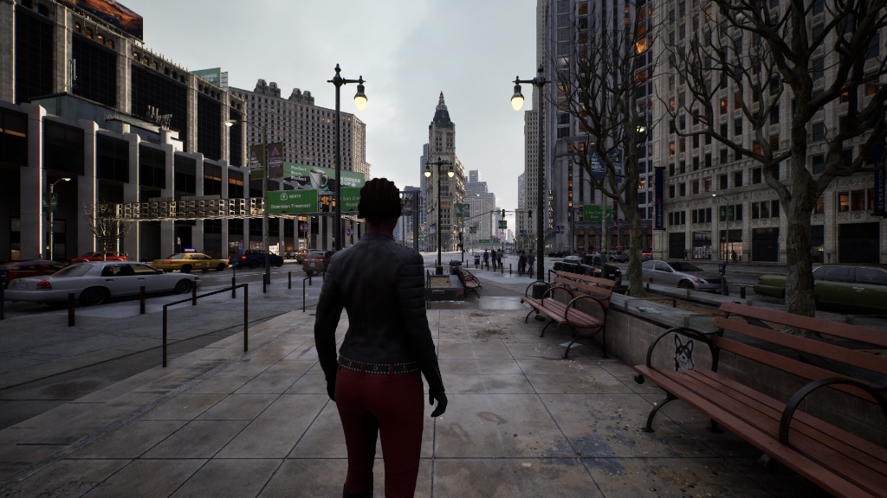
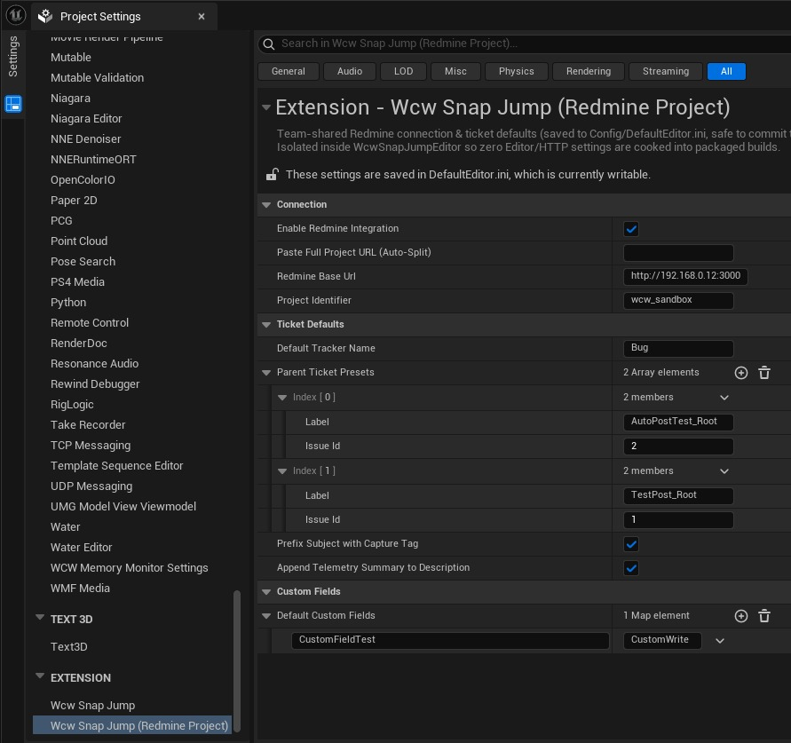
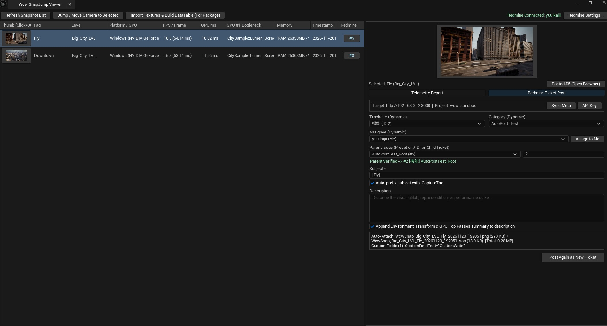
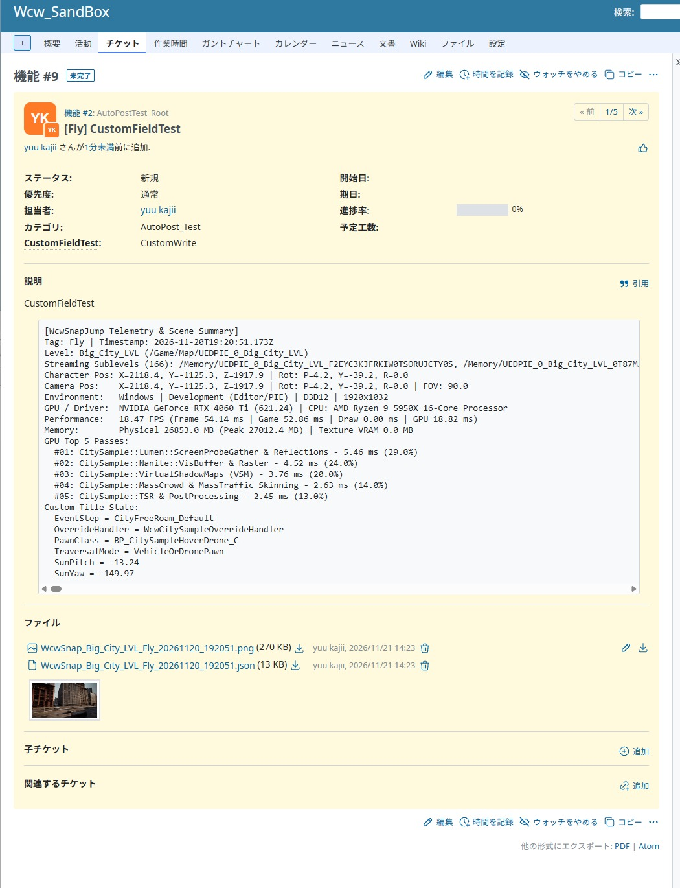
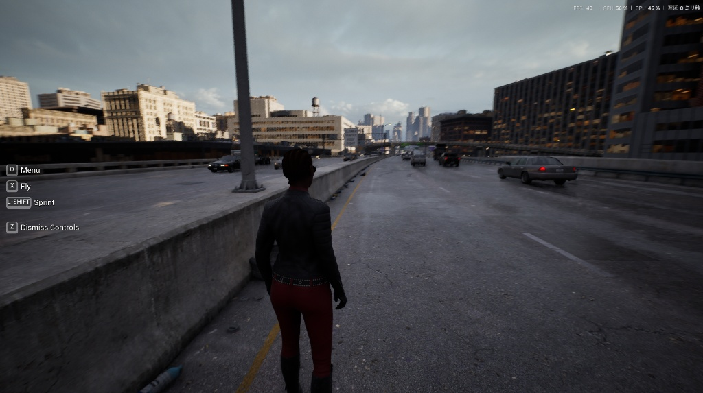

# WcwSnapJump (Beta) — Unreal Engine Visual Scene Snapshot & Instant Jump Plugin

**Language / 言語**: **[English](#english) | [日本語](#日本語)**

**Version**: `0.2.0 (Beta)` | **License**: MIT License | **Supported Unreal Engine**: UE 5.6 – 5.8+

**Platforms**: Windows, PS5, Xbox Series X|S, Nintendo Switch / Switch 2 | **Created by**: [WinterCrownWORKS](https://winter-crown-works.com)



## English

> **Beta Release Notice (`v0.2.0` Beta)**
>
> This plugin is currently released as **`v0.2.0` Beta** (`"IsBetaVersion": true` in `WcwSnapJump.uplugin`). New in `v0.2.0`: direct **Redmine Ticket Creation** inside `Wcw SnapJump Viewer` (Editor-only module, zero runtime overhead, dynamic Assignee/Priority/CustomField resolution, and Title-defined interactive UI controls via `UWcwSnapJumpHandler`). Issues and feedback are welcome!

`WcwSnapJump` is an Unreal Engine C++ and Blueprint plugin that embeds **world coordinates, active levels, capture platform & GPU hardware info, frame telemetry (Stat Unit / GPU Top 10 / Memory), and custom title event or cutscene states** directly inside a lightweight PNG file (via a custom `WcwSnapJump` `tEXt` chunk right after `IHDR`). It enables thumbnail browsing, Redmine ticket creation, and one-click / one-button scene teleportation across **Unreal Editor, PIE, and packaged console/PC builds**.

For QA bug reporting and performance profiling, simply sharing the captured snapshot files (`.png` / `.json`) from `Saved/WcwSnapJump/`—or posting them directly to Redmine from `Wcw SnapJump Viewer`—immediately shows which hardware recorded the spike and lets any team member jump straight to that exact location and game state.

* **PDF Manual (English)**: [`Doc/WcwSnapJump_Documentation_EN.pdf`](Doc/WcwSnapJump_Documentation_EN.pdf)
* **PDF Manual (Japanese)**: [`Doc/WcwSnapJump_Documentation.pdf`](Doc/WcwSnapJump_Documentation.pdf)

### Demonstration Videos (YouTube — Captured in UE 5.8 `CitySample`)

| Demo Part | Key Workflow Shown | YouTube Link |
| ----- | ----- | ----- |
| **1. PIE Capture & Jump** (`Shot & Jump` / 29s) | Capturing snapshots with `Wcw.SnapJump.Shot` in PIE and jumping across locations from the left-half overlay menu | [https://www.youtube.com/watch?v=\_9tkhtKsjqI](https://www.youtube.com/watch?v=_9tkhtKsjqI) |
| **2. Editor Viewer & Asset Build** (`EditorCheck` / 32s) | Comparing GPU load in `Wcw SnapJump Viewer`, 1-click Editor camera jump, and automated `DT_WcwSnapJump` baking | [https://www.youtube.com/watch?v=7EHGRMnf3EI](https://www.youtube.com/watch?v=7EHGRMnf3EI) |
| **3. Packaged Build Jump** (`Packaged Build` / 36s) | Capturing live snapshots in a packaged build, unified listing with pre-cooked DataTable rows, and gamepad scene jumping | [https://www.youtube.com/watch?v=lxPwkk5PGUg](https://www.youtube.com/watch?v=lxPwkk5PGUg) |
| **4. Direct Redmine Ticket Post** (`v0.2.0` / 46s) | Selecting Tracker, Category, Assignee & Parent Issue in `Wcw SnapJump Viewer`, posting with `.png`/`.json` attached, and opening in browser | [https://www.youtube.com/watch?v=aGKkPdFA2VY](https://www.youtube.com/watch?v=aGKkPdFA2VY) |

### Key Features

* **Self-Contained PNG Metadata & Hardware Telemetry (`FWcwSnapJumpSerializer` / `FWcwEnvironmentSnapshot`)**
  * Embeds serialized JSON into a custom `WcwSnapJump` `tEXt` chunk right after `IHDR` inside an aspect-preserved lightweight PNG (`512px` max edge by default; `512x288` for 16:9), plus an optional plain-text `.json` sidecar.
  * Automatically records **capture platform (`Windows` / `PS5` / `XSX` / `Switch`), build environment (`Editor/PIE` vs `Packaged`), GPU adapter & driver version, CPU brand, RHI (`D3D12` / `Vulkan`), and viewport resolution** alongside transform and GPU/memory stats.
* **Editor Telemetry Comparison & Jump Viewer (`Wcw SnapJump Viewer`)**
  * Open `Window -> Wcw SnapJump Viewer` to compare **Platform / GPU**, FPS, frame time, GPU ms, #1 GPU bottleneck pass, and RAM usage side by side. Clicking a thumbnail **instantly moves the Editor Perspective camera** (or triggers a runtime jump during PIE).
* **Direct Redmine Ticket Creation in Editor (`v0.2.0` — Editor-Isolated)**
  * Post tickets (or child tickets under a parent issue) directly from the **`Redmine Ticket Post`** tab in `Wcw SnapJump Viewer` with automatic `.png` and `.json` binary attachment (`POST /uploads.json` + `POST /issues.json`).
  * Team connection URL & parent ticket presets live in `Config/DefaultEditor.ini`, while each user's personal `X-Redmine-API-Key` (compatible with 2FA-enabled Redmine accounts) is stored strictly in local `Saved/Config/` (`EditorPerProjectUserSettings.ini`), preventing accidental Git/Perforce commits.
  * Dynamically fetches project-specific **Trackers, Issue Categories, Issue Priorities (`/enumerations/issue_priorities.json`), Issue Custom Fields (`GET /projects/<id>.json?include=trackers,issue_categories,issue_custom_fields` + list options & `multiple` detection), and Assignable Project Members (`GET /projects/<id>/memberships.json`)**, automatically resolves human-readable Custom Field names (`TMap<FString, FString>`) to numeric Redmine IDs, and writes the created `#IssueID` into the local `.json` sidecar to prevent duplicate posting and open tickets in the browser in 1 click.
* **One-Click Asset Pipeline for Console & Packaged Builds**
  * Clicking **`Import Textures & Build DataTable (For Package)`** imports all PNGs as persistent UI `UTexture2D` assets under `<DataTableFolder>/CustomScreenShot/`, saves `.uasset` files to disk via `UPackage::SavePackage`, updates `Config/DefaultGame.ini`, and registers `DirectoriesToAlwaysCook` automatically.
  * At runtime, pre-cooked `DefaultSnapJumpDataTable` rows (with `AssetRegistry` auto-discovery fallback) merge seamlessly with live in-session captures (`SessionCapturedSnaps`).
* **Console & Gamepad Ready Runtime Overlay (`UWcwSnapJumpBrowserWidget`)**
  * Left-half, two-tier overlay UI keeps the right half of the game viewport visible.
  * Applies `FInputModeUIOnly` + priority-0 `IInputProcessor` + per-frame focus enforcement so gamepad navigation works reliably even alongside `CommonUI` or right after closing the debug console.
  * Automatically follows Nintendo Switch / Switch 2 (Right `A` = Accept, Bottom `B` = Back) and PS5 / Xbox / PC conventions via `EKeys::Virtual_Accept` / `Virtual_Gamepad_Accept`.
* **Non-Destructive Title-Side Customization (`UWcwSnapJumpHandler`)**
  * Subclass in C++ or Blueprint (or bind Subsystem lambdas) to customize stat/GPU gathering, record quest flags or cutscene playback timestamps, format UI text, **expose Title-specific interactive Redmine UI controls (Priority dropdown, Text/List/Multi-Select/Boolean Custom Fields)**, customize Redmine subject/description/presets/fields, hook into custom async stage loaders, and trigger post-jump event/cutscene restoration without touching plugin source files.

### Default Embedded Metadata Fields (`FWcwSnapJumpData`)

| Category | Struct / Primary Fields | Example Recorded Values |
| ----- | ----- | ----- |
| **Identity & Timestamp** | `CaptureTag`, `Timestamp`, `SourceFilePath` | `"downtown_Heavy"`, `"2026-11-20T11:52:48Z"` |
| **Platform & Hardware** (`FWcwEnvironmentSnapshot`) | `PlatformName`, `BuildEnvironment`, `GpuAdapterName`, `GpuDriverVersion`, `CpuBrand`, `RhiName`, `ViewportResolution` | `Windows` / `PS5` / `Switch`, `Development (Editor/PIE)` / `Development (Packaged)`, `NVIDIA GeForce RTX 4060 Ti`, `D3D12`, `1920x1080` |
| **Level & Transform** | `LevelName`, `LevelPackageName`, `LoadedStreamingLevels`, `CharacterLocation` / `Rotation`, `CameraLocation` / `Rotation` / `FOV` | Persistent level path, loaded streaming sublevels, Pawn transform, camera transform & FOV |
| **Frame Timing (`stat unit`)** (`FWcwStatSnapshot`) | `FPS`, `FrameTimeMs`, `GameThreadTimeMs`, `RenderThreadTimeMs`, `GpuTimeMs`, `RhiThreadTimeMs`, `DrawCalls`, `PrimitivesDrawn` | `22.20 FPS`, Frame `45.05 ms`, GT `43.13 ms`, GPU `16.31 ms`, DrawCalls `1417` |
| **Memory Usage** (`FWcwMemorySnapshot`) | `UsedPhysicalMemoryMB`, `PeakPhysicalMemoryMB`, `UsedVirtualMemoryMB`, `AvailablePhysicalMemoryMB` | Process physical RAM used, peak physical RAM, and available physical RAM (MB) |
| **Top GPU Bottlenecks** (`TArray<FWcwGpuPassEntry>`) | `GpuTop10Passes` (`PassName`, `DurationMs`, `PercentageOfFrame`) | Top N passes (default 10) with GPU duration (ms) and frame share (%) |
| **Title Custom Data** | `CustomTitleTags` (`TMap<FString, FString>`), `CustomJsonPayload` (`FString`) | Quest/event step IDs, cutscene asset & playback seconds, custom `USTRUCT` JSON |

### Repository Directory Structure

Place `WcwSnapJump` under `Plugins/WcwSnapJump/` in your Unreal project. Files inside `Doc/` and `WcwSnapJumpEditor` are excluded from packaged builds, adding zero size overhead to ROMs.

```text
WcwSnapJump/
├── WcwSnapJump.uplugin                 # Plugin descriptor (v0.2.0 Beta / Runtime + Editor)
├── LICENSE                             # MIT License
├── Doc/                                # PDF manuals (EN/JA) & README screenshots
│   ├── WcwSnapJump_Documentation_EN.pdf
│   ├── WcwSnapJump_Documentation.pdf
│   └── images/
├── Samples/                            # Optional Title Override sample plugin (archived, v0.2.0)
│   └── WcwSnapJumpCityTest_Plugin.zip
├── README.md                           # Bilingual repository documentation (EN / JA)
└── Source/
    ├── WcwSnapJump/                    # Runtime module (Windows, Console & Packaged — zero HTTP/Slate dep)
    └── WcwSnapJumpEditor/              # Editor-only Viewer, DataTable baker & Redmine REST client
```

### Quick Start, Redmine Ticket Posting & Team Sharing Workflow

#### 1. Installation

1. Clone or extract `WcwSnapJump` into `YourProject/Plugins/WcwSnapJump/` (`YourProject/Plugins/WcwSnapJump/WcwSnapJump.uplugin`).
2. Build your project and launch Unreal Editor (UE 5.6 and UE 5.7 / 5.8+ input API differences are handled automatically via engine version macros).

#### 2. Capturing Snapshots (Paired `.png` & `.json` Output)

Run the console command or Blueprint node during PIE, Standalone, or on a Console/PC packaged build:

* **Console Command**: `Wcw.SnapJump.Shot [OptionalTag]` *(e.g. `Wcw.SnapJump.Shot downtown_Heavy`)*
* **Blueprint / C++**: `UWcwSnapJumpLibrary::CaptureWcwSnap(this, TEXT("downtown_Heavy"));`
* **Paired `.png` & `.json` Roles** (`Saved/WcwSnapJump/WcwSnap_<Level>_<Tag>_<Timestamp>.png` / `.json`):
  * **`.png` Snapshot (Required / Self-Contained)**: Carries all serialized metadata inside its binary `tEXt` chunk. **Editor Viewer, Runtime Jump, and DataTable baking work from the `.png` file alone.**
  * **`.json` Sidecar (Optional / Default `ON`)**: Human-readable JSON exported alongside the PNG for plain-text inspection, CI parsing, and local Redmine posted-ticket tracking.


#### 3. Posting Tickets Directly to Redmine (`v0.2.0` — [Video Demo](https://www.youtube.com/watch?v=aGKkPdFA2VY))

1. **Enable Redmine REST API**: In Redmine `Administration -> Settings -> API`, ensure **Enable REST web service** is checked.
2. **Project Connection Setup (Shared `Config/DefaultEditor.ini`)**: Open `Project Settings -> Extension -> Wcw Snap Jump (Redmine Project)` (or click **`Redmine Settings...`** inside `Wcw SnapJump Viewer`) and paste your Redmine project URL (e.g. `http://192.168.1.50:3000/projects/sandbox`) into **`Paste Full Project URL (Auto-Split)`**—it automatically populates `RedmineBaseUrl` (with port) and `ProjectIdentifier`. Optionally register `ParentTicketPresets`, `DefaultCustomFields` (`Key = CustomFieldName`), and `DefaultExtraIssueFields`.
3. **Personal API Key Setup (Local `Saved/Config/`)**: Open the **`Redmine Ticket Post`** tab in `Wcw SnapJump Viewer`, paste your personal API key from Redmine `/my/account`, and click **`Test & Save Local`**. Trackers, Categories, Priorities, Assignees, and Custom Field definitions for the project are fetched automatically.
4. **One-Click Ticket Post**: Select a snapshot row, choose Tracker / Category / Assignee (or **`Assign to Me`**) / Parent Issue (plus any Title-defined Priority or Custom Field UI controls), edit the Subject (`[Tag]` auto-prefixed) and Description, and click **`Post Ticket to Redmine`**. Both `.png` and `.json` are attached automatically, and the created `#IssueID` badge appears in the `Redmine` column (click to open in browser).







#### 4. Sharing Snapshots Manually & Editor DataTable Generation

1. **Folder Sharing**: Share `.png` + `.json` from `<Project>/Saved/WcwSnapJump/`, drop into another machine's `Saved/WcwSnapJump/`, and click **`Refresh Snapshot List`**.
2. **Packaged Build Baking**: In `Window -> Wcw SnapJump Viewer`, click **`Import Textures & Build DataTable (For Package)`** to generate `/Game/WcwSnapJump/DT_WcwSnapJump` and `CustomScreenShot/T_WcwSnap_*.uasset`, save `.uasset` packages to disk, and register `DefaultGame.ini` + `DirectoriesToAlwaysCook`.


#### 5. Runtime / Console Overlay Menu & Controls

Open the left-half overlay menu in-game via `Wcw.SnapJump.ToggleMenu` or `r.Wcw.SnapJump.Menu 1` ([PIE Demo](https://www.youtube.com/watch?v=_9tkhtKsjqI) | [Packaged Demo](https://www.youtube.com/watch?v=lxPwkk5PGUg)).




| Action | Controller (Gamepad) | Keyboard / Mouse |
| ----- | ----- | ----- |
| **Select Up / Down (Auto-scroll)** | `D-Pad Up / Down` or `Left Stick Up / Down` | `Up` / `Down` keys, or click row text |
| **Fast Page Step (5 Rows)** | `LB` / `RB` (`L1` / `R1` / `L` / `R`) | `PageUp` / `PageDown` (`Home` / `End`) |
| **Scroll Detail Report** | `Right Stick Up / Down` (smooth analog scroll) | Mouse wheel over detail pane |
| **Jump to Selected Scene** | **Accept Button** (Switch: Right `A` / PS & Xbox: Bottom `Cross` & `A`) | `Enter` / `Space`, or **click thumbnail** |
| **Close Menu** | **Back Button** (Switch: Bottom `B` / PS & Xbox: Right `Circle` & `B`) | `Escape`, or click `Close` button |

### Console Commands, CVars & Project Settings Reference

| Name | Type / Default | Description |
| ----- | ----- | ----- |
| `Wcw.SnapJump.Shot [Tag]` | Command | Captures a lightweight PNG and embeds hardware, transform, and stat metadata. |
| `Wcw.SnapJump.ToggleMenu` | Command | Toggles the left-half runtime browser overlay. |
| `Wcw.SnapJump.JumpFile <File.png>` | Command | Jumps directly using a specified PNG filename in `Saved/WcwSnapJump/`. |
| `r.Wcw.SnapJump.Menu` | CVar (`0`) | `1` opens the runtime overlay menu; `0` closes it. |
| `r.Wcw.SnapJump.FontScale` | CVar (`1.0`) | Dynamically scales runtime menu font size (`0.5` – `3.0`). |
| `r.Wcw.SnapJump.Resolution` | CVar (`0`) | Overrides max pixel edge for saved PNGs (`0` uses Project Settings). |
| `r.Wcw.SnapJump.ShowUI` | CVar (`0`) | `1` includes Slate/UMG UI widgets in captured screenshots. |
| `r.Wcw.SnapJump.Enable` | CVar (`1`) | Master runtime toggle; `0` disables snapshot capture. |
| `bAutoRestoreStreamingLevels` | Setting (`true`) | Automatically loads & makes visible recorded `StreamLevel`s (stripping `UEDPIE_` and skipping `/Memory/` & `/_Generated_/` cells) before player teleportation. |
| `bBlockOnStreamLevelLoadForJump` | Setting (`true`) | Synchronously flushes pending `StreamLevel` loading & physics collision (`BlockTillLevelStreamingCompleted`) before teleport to prevent floor-fall. |
| `bTreatRegisteredStreamLevelAsSameWorld` | Setting (`true`) | Keeps `PersistentLevel` alive and streams in-place when jumping to a registered `StreamLevel` instead of calling `OpenLevel`. |
| `bExcludeTransientStreamingCells` | Setting (`true`) | Excludes transient World Partition cells (`/Memory/...`, `/_Generated_/...`) when recording `LoadedStreamingLevels`. |

### Title-Side Override Guide (`UWcwSnapJumpHandler`)

Subclass `UWcwSnapJumpHandler` (in C++ or Blueprint) and assign it under `Project Settings -> Extension -> Wcw Snap Jump -> CustomJumpHandlerClass`:

* **`OnGatherTitleCustomMeta` / `GatherStatAndGpuTelemetry`**: Append quest/event IDs, cutscene timestamps, or custom title GPU profiler metrics.
* **`FormatThumbnailSummary` / `FormatDetailedReport`**: Customize row summary and detail pane text across both Editor Viewer and Runtime UI.
* **`ShouldTransitionLevel` / `HandleLevelTransition` / `RestoreStreamingLevels` / `HandlePostJumpSetup`**: Route map loads through your custom fade & async stage loader and restore cutscene/event state after jumping.
* **`GatherIssueTrackerUiFields` (`v0.2.0+`)**: Declare interactive Title-specific UI controls (**Priority dropdown**, **Text Box**, **Single-Select Dropdown**, **Multi-Select Checkboxes**, or **Boolean CheckBox** for Redmine Custom Fields & Standard Fields) rendered directly inside `Wcw SnapJump Viewer`.
* **`FormatIssueTrackerSubject` / `FormatIssueTrackerTelemetryBlock` (`v0.2.0+`)**: Customize Redmine ticket Subject naming rules (e.g. `[Platform][Level][Tag]`) and `<pre>` / Markdown telemetry blocks.
* **`GatherIssueTrackerPresetSelection` / `GatherIssueTrackerIssueFields` / `GatherIssueTrackerCustomFields` (`v0.2.0+`)**: Auto-select Redmine Tracker/Category/Assignee/Parent Issue per snapshot, and inject standard `issue` fields (`priority_id`, `fixed_version_id`) or name-based `custom_fields` (`TMap<FString, FString>`).

#### Tutorial / Sample Plugin (Built for UE 5.8 `CitySample`)

* **Archive (`v0.2.0`)**: [`Samples/WcwSnapJumpCityTest_Plugin.zip`](Samples/WcwSnapJumpCityTest_Plugin.zip)

## 日本語

**[▲ Back to Top / English](#wcwsnapjump-beta--unreal-engine-visual-scene-snapshot--instant-jump-plugin)**

> **Beta Release Notice（ベータ版公開について）**
>
> 本プラグインは現在 **`v0.2.0` ベータ版**（`WcwSnapJump.uplugin` にて `"IsBetaVersion": true` 指定）として公開されています。`v0.2.0` では Editor の **`Wcw SnapJump Viewer` から直接 Redmine へチケット起票・添付送信できる連携機能**（`WcwSnapJumpEditor` モジュール内完結・ランタイム負荷ゼロ・担当者＆優先度＆リスト型CustomField動的解決・タイトル側からのRedmine専用UIコントロール追加＆全項目Override対応）を追加しました。Issueやフィードバックを歓迎します。

`WcwSnapJump` は、プレイ中の軽量スクリーンショット（PNGファイル自体）に **座標・カレントレベル・撮影プラットフォーム＆GPU／ハードウェア環境情報・フレーム負荷（Stat / GPU Top 10 / メモリ）・タイトル固有のイベント進捗度やカットシーン再生情報** を直接バイナリ埋め込み（PNG `tEXt` チャンク）し、**Editor・PIE・コンソール実機（パッケージビルド）でのサムネイル一覧表示・Redmineチケット自動添付起票・ワンクリックでのシーンジャンプ＆状態再現**を実現する Unreal Engine C++ / Blueprint プラグインです。

* **PDFマニュアル（日本語版）**: [`Doc/WcwSnapJump_Documentation.pdf`](Doc/WcwSnapJump_Documentation.pdf)
* **PDFマニュアル（英語版）**: [`Doc/WcwSnapJump_Documentation_EN.pdf`](Doc/WcwSnapJump_Documentation_EN.pdf)

### デモンストレーション動画（YouTube・UE 5.8 `CitySample` 実機収録）

| デモパート | 確認できる主な動作内容 | YouTube リンク |
| ----- | ----- | ----- |
| **1. PIE 撮影＆連続ジャンプ** (`Shot & Jump` / 29秒) | PIE実行中の `Wcw.SnapJump.Shot` 撮影と、左半分オーバーレイメニューからの連続ロケーションジャンプ | [https://www.youtube.com/watch?v=\_9tkhtKsjqI](https://www.youtube.com/watch?v=_9tkhtKsjqI) |
| **2. Editor ビューア＆パッケージ構築** (`EditorCheck` / 32秒) | `Wcw SnapJump Viewer` での負荷比較、サムネイルクリックによるEditorカメラ即移動、`DT_WcwSnapJump` 自動生成 | [https://www.youtube.com/watch?v=7EHGRMnf3EI](https://www.youtube.com/watch?v=7EHGRMnf3EI) |
| **3. パッケージ実機 撮影＆ジャンプ** (`Packaged Build` / 36秒) | パッケージ版での新規スナップショット追加撮影、事前焼き込みDataTableとの統合一覧表示、コントローラー操作での即ジャンプ | [https://www.youtube.com/watch?v=lxPwkk5PGUg](https://www.youtube.com/watch?v=lxPwkk5PGUg) |
| **4. Redmine チケット直接起票** (`v0.2.0` 新機能 / 46秒) | `Wcw SnapJump Viewer` からのトラッカー・担当者・親チケット選択、`.png`/`.json` 自動添付起票とブラウザ確認 | [https://www.youtube.com/watch?v=aGKkPdFA2VY](https://www.youtube.com/watch?v=aGKkPdFA2VY) |

### 主な特徴

* **PNG単体完結のメタデータ＆撮影環境埋め込み (`FWcwSnapJumpSerializer` / `FWcwEnvironmentSnapshot`)**
  * 元画面のアスペクト比を維持した軽量PNG（既定で長辺 `512px`、16:9時は `512x288`）の `IHDR` 直後に独自 `tEXt` チャンク（`WcwSnapJump`）を埋め込み、同名 `.json` サイドカーも対で出力できます。
* **Editor専用の負荷・環境比較＆ジャンプビューア (`Wcw SnapJump Viewer`)**
  * `Window -> Wcw SnapJump Viewer` から **Platform / GPU**・FPS・GPU時間・GPUボトルネック1位・メモリ使用量を比較し、サムネイルクリックで **Editorカメラの即移動（非PIE時）** または **ランタイムジャンプ（PIE実行中）** を行えます。
* **Redmine チケット直接起票・自動添付 (`v0.2.0` 新機能 / Editorモジュール完全分離)**
  * `Wcw SnapJump Viewer` 右ペインの **`Redmine Ticket Post`** タブから、選択中の `.png` と `.json` を自動バイナリアップロード（`POST /uploads.json`）したうえで子チケット・通常チケットを直接起票できます。
  * **共有Configと個人認証の安全な分離**: 接続先URL（ポート込み）や親チケット候補リストは `Config/DefaultEditor.ini` でチーム共有し、個人の `ApiAccessKey`（`X-Redmine-API-Key` ヘッダ送信・2段階認証有効アカウントでも利用可能）は `Saved/Config/` 配下の `EditorPerProjectUserSettings.ini` にのみ保存されるため、Git / Perforce への誤コミットが起きません。
  * **トラッカー・カテゴリ・優先度・担当者・カスタムフィールド（テキスト／リスト／複数選択）の動的取得**: `GET /projects/<id>.json?include=trackers,issue_categories,issue_custom_fields`・`GET /enumerations/issue_priorities.json`・`GET /projects/<id>/memberships.json` でサーバー設定を自動取得。カスタムフィールドはフィールド名（例: `"CustomFieldTest"`, `"CustomFieldTest_List"`）で指定でき、数値IDへの変換および `multiple=true` リスト項目の配列JSON送信まで自動処理します。
  * **二重起票の防止**: 起票成功時に新規チケット番号（例: `#9`）をローカル `.json` へ書き戻し、一覧の `Redmine` 列から1クリックでブラウザの該当チケットを開けます。
* **コンソール実機・パッケージビルド完全対応のアセット自動構築＆パッド操作対応UI**
  * **`Import Textures & Build DataTable (For Package)`** 1ボタンでパッケージ組み込み用アセットを生成・Cook登録し、Switch / Switch 2・PS5・Xbox・PC のコントローラー操作で巡回ジャンプできます。
* **タイトル側で自在にOverrideできる拡張設計 (`UWcwSnapJumpHandler`)**
  * プラグイン無改造で C++ / Blueprint から状態収集・ロード待ち・ジャンプ後復元に加え、**`GatherIssueTrackerUiFields` によるタイトル専用のRedmine操作UI（優先度ドロップダウン・テキスト／リスト型CustomField等）の追加**や、件名規則・テレメトリ本文・自動フィールド注入まで一括カスタマイズ可能です。

### Redmine 連携セットアップ手順（`v0.2.0` — [デモ動画](https://www.youtube.com/watch?v=aGKkPdFA2VY)）

1. **Redmine側の確認**: Redmine管理画面の `管理 -> 設定 -> API` にて **「RESTによるWebサービスを有効にする」** にチェックが入っていることを確認します。
2. **プロジェクト共有設定（`Config/DefaultEditor.ini`）**: `Wcw SnapJump Viewer` 右上の **`Redmine Settings...`**（または `Project Settings -> Extension -> Wcw Snap Jump (Redmine Project)`）を開き、**`Paste Full Project URL (Auto-Split)`** にプロジェクトURL（例: `http://192.168.1.50:3000/projects/sandbox`）を貼り付けると、ポート込みの `RedmineBaseUrl` と `ProjectIdentifier` に自動分割されます。親チケット候補は `ParentTicketPresets`、カスタムフィールド固定値は `DefaultCustomFields`（Keyにフィールド名）へ登録できます。
3. **個人APIアクセスキーのローカル保存（`Saved/Config/`）**: Redmineの「個人設定（`/my/account`）」右欄にある **APIアクセスキー** をコピーし、`Wcw SnapJump Viewer` の **`Redmine Ticket Post`** タブ内に入力して **`Test & Save Local`** を押します（接続確認と同時にプロジェクトのトラッカー・カテゴリ・優先度・担当者・カスタムフィールド定義が自動取得されます）。
4. **チケット投稿**: 左の一覧でスナップショットを選び、トラッカー・カテゴリ・担当者（または **`Assign to Me`**）・親チケット（およびタイトル専用UI欄の優先度やカスタムフィールド）・題名・説明を入力して **`Post Ticket to Redmine`** を押すと、`.png` と `.json` が自動添付されたチケットが作成され、一覧の `Redmine` 列に `#番号` リンクボタンが表示されます。


### タイトル側でのOverride（C++ / Blueprint カスタマイズ例）

```cpp
// MyTitleSnapJumpHandler.cpp（タイトル専用のRedmine操作UI追加 ＋ 自動フィールド連携例）
void UMyTitleSnapJumpHandler::GatherIssueTrackerUiFields_Implementation(
	const FWcwSnapJumpData& SnapData, TArray<FWcwIssueTrackerUiField>& OutUiFields)
{
	// 1. 優先度 (priority_id) ドロップダウン（Redmineの /enumerations/issue_priorities.json から候補と既定値を自動取得）
	FWcwIssueTrackerUiField PriorityUi;
	PriorityUi.FieldKey = TEXT("priority_id");
	PriorityUi.DisplayLabel = TEXT("Priority");
	PriorityUi.ControlType = EWcwIssueTrackerUiControlType::Dropdown;
	PriorityUi.TargetType = EWcwIssueTrackerFieldTarget::RedminePriority;
	OutUiFields.Add(PriorityUi);

	// 2. テキスト型 CustomField 入力欄
	FWcwIssueTrackerUiField TextCf;
	TextCf.FieldKey = TEXT("CustomFieldTest");
	TextCf.DisplayLabel = TEXT("CustomFieldTest");
	TextCf.ControlType = EWcwIssueTrackerUiControlType::TextBox;
	TextCf.TargetType = EWcwIssueTrackerFieldTarget::CustomField;
	TextCf.DefaultValue = TEXT("CustomWrite");
	OutUiFields.Add(TextCf);

	// 3. リスト型 CustomField ドロップダウン（Redmine側の候補リスト・multiple=true配列形式も自動同期）
	FWcwIssueTrackerUiField ListCf;
	ListCf.FieldKey = TEXT("CustomFieldTest_List");
	ListCf.DisplayLabel = TEXT("CustomFieldTest_List");
	ListCf.ControlType = EWcwIssueTrackerUiControlType::Dropdown; // MultiSelect で複数チェックボックスも可
	ListCf.TargetType = EWcwIssueTrackerFieldTarget::CustomField;
	ListCf.DefaultValue = TEXT("None");
	ListCf.Options = {
		FWcwIssueTrackerUiOption(TEXT("(Unselected)"), TEXT("")),
		FWcwIssueTrackerUiOption(TEXT("None"), TEXT("None")),
		FWcwIssueTrackerUiOption(TEXT("Test_1"), TEXT("Test_1")),
		FWcwIssueTrackerUiOption(TEXT("Test_2"), TEXT("Test_2")),
		FWcwIssueTrackerUiOption(TEXT("Test_3"), TEXT("Test_3"))
	};
	OutUiFields.Add(ListCf);
}
```

#### チュートリアル／サンプルプラグイン（UE 5.8 `CitySample` 向け）

* **同梱ZIP (`v0.2.0`)**: [`Samples/WcwSnapJumpCityTest_Plugin.zip`](Samples/WcwSnapJumpCityTest_Plugin.zip)

## License / ライセンス

Released under the **MIT License**. Free for commercial and non-commercial use, modification, and redistribution (see [`LICENSE`](LICENSE) for details).

本プラグインは **MIT License** の下で公開・配布されています。商用・非商用を問わず、自由にご利用・改変・再配布いただけます（詳細は [`LICENSE`](LICENSE) をご参照ください）。

Copyright (c) 2026 WinterCrownWORKS — [https://winter-crown-works.com](https://winter-crown-works.com)