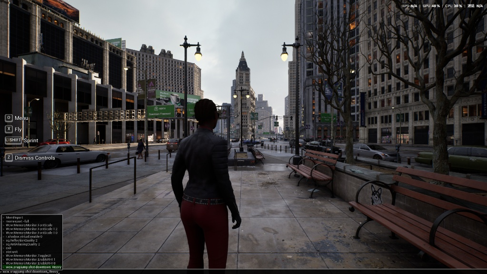
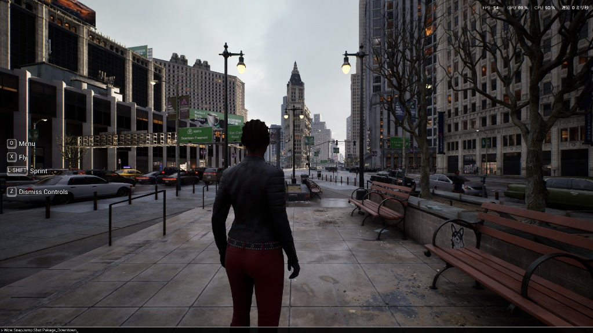
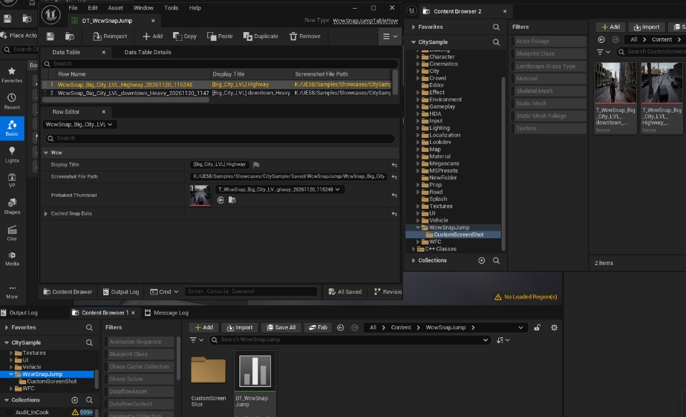
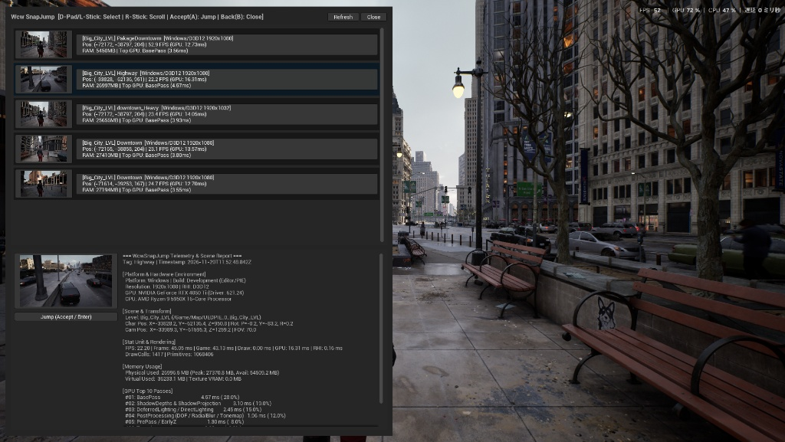

# WcwSnapJump (Beta) — Unreal Engine Visual Scene Snapshot & Instant Jump Plugin

**Language / 言語**: **[English](#english) | [日本語](#日本語)**

**Version**: `0.1.0 (Beta)` | **License**: MIT License | **Supported Unreal Engine**: UE 5.6 – 5.8+

**Platforms**: Windows, PS5, Xbox Series X|S, Nintendo Switch / Switch 2 | **Created by**: [WinterCrownWORKS](https://winter-crown-works.com)


## English

> **Beta Release Notice (`v0.1.0` Beta)**
>
> This plugin is currently released as **`v0.1.0` Beta** (`"IsBetaVersion": true` in `WcwSnapJump.uplugin`). Core features—including PNG metadata embedding, automatic platform & GPU hardware telemetry, Editor Viewer, packaged DataTable asset generation, console gamepad navigation, and title-side Override hooks—have been verified on target builds. API details, struct fields, or UI layouts may evolve toward `v1.0.0` based on feedback. Issues and feedback are welcome!

`WcwSnapJump` is an Unreal Engine C++ and Blueprint plugin that embeds **world coordinates, active levels, capture platform & GPU hardware info, frame telemetry (Stat Unit / GPU Top 10 / Memory), and custom title event or cutscene states** directly inside a lightweight PNG file (via a custom `WcwSnapJump` `tEXt` chunk right after `IHDR`). It enables thumbnail browsing and one-click / one-button scene teleportation across **Unreal Editor, PIE, and packaged console/PC builds**.

For QA bug reporting and performance profiling, exchanging a single PNG from `Saved/WcwSnapJump/` immediately shows which hardware recorded the spike and lets any team member jump straight to that exact location and game state.

* **PDF Manual (English)**: [`Doc/WcwSnapJump_Documentation_EN.pdf`](Doc/WcwSnapJump_Documentation_EN.pdf)
* **PDF Manual (Japanese)**: [`Doc/WcwSnapJump_Documentation.pdf`](Doc/WcwSnapJump_Documentation.pdf)

### Demonstration Videos (YouTube — Captured in UE 5.8 `CitySample`)

| Demo Part | Key Workflow Shown | YouTube Link |
| ----- | ----- | ----- |
| **1. PIE Capture & Jump** (`Shot & Jump` / 29s) | Capturing snapshots with `Wcw.SnapJump.Shot` in PIE and jumping across locations from the left-half overlay menu | [https://www.youtube.com/watch?v=\_9tkhtKsjqI](https://www.youtube.com/watch?v=_9tkhtKsjqI) |
| **2. Editor Viewer & Asset Build** (`EditorCheck` / 32s) | Comparing GPU load in `Wcw SnapJump Viewer`, 1-click Editor camera jump, and automated `DT_WcwSnapJump` baking | [https://www.youtube.com/watch?v=7EHGRMnf3EI](https://www.youtube.com/watch?v=7EHGRMnf3EI) |
| **3. Packaged Build Jump** (`Packaged Build` / 36s) | Capturing live snapshots in a packaged build, unified listing with pre-cooked DataTable rows, and gamepad scene jumping | [https://www.youtube.com/watch?v=lxPwkk5PGUg](https://www.youtube.com/watch?v=lxPwkk5PGUg) |

### Key Features

* **Self-Contained PNG Metadata & Hardware Telemetry (`FWcwSnapJumpSerializer` / `FWcwEnvironmentSnapshot`)**
  * Embeds serialized JSON into a custom `WcwSnapJump` `tEXt` chunk right after `IHDR` inside an aspect-preserved lightweight PNG (`512px` max edge by default; `512x288` for 16:9), plus an optional plain-text `.json` sidecar.
  * Automatically records **capture platform (`Windows` / `PS5` / `XSX` / `Switch`), build environment (`Editor/PIE` vs `Packaged`), GPU adapter & driver version, CPU brand, RHI (`D3D12` / `Vulkan`), and viewport resolution** alongside transform and GPU/memory stats.
* **Editor Telemetry Comparison & Jump Viewer (`Wcw SnapJump Viewer`)**
  * Open `Window -> Wcw SnapJump Viewer` to compare **Platform / GPU**, FPS, frame time, GPU ms, #1 GPU bottleneck pass, and RAM usage side by side. Clicking a thumbnail **instantly moves the Editor Perspective camera** (or triggers a runtime jump during PIE).
* **One-Click Asset Pipeline for Console & Packaged Builds**
  * Clicking **`Import Textures & Build DataTable (For Package)`** imports all PNGs as persistent UI `UTexture2D` assets under `<DataTableFolder>/CustomScreenShot/`, saves `.uasset` files to disk via `UPackage::SavePackage`, updates `Config/DefaultGame.ini`, and registers `DirectoriesToAlwaysCook` automatically.
  * At runtime, pre-cooked `DefaultSnapJumpDataTable` rows (with `AssetRegistry` auto-discovery fallback) merge seamlessly with live in-session captures (`SessionCapturedSnaps`).
* **Console & Gamepad Ready Runtime Overlay (`UWcwSnapJumpBrowserWidget`)**
  * Left-half, two-tier overlay UI keeps the right half of the game viewport visible.
  * Applies `FInputModeUIOnly` + priority-0 `IInputProcessor` + per-frame focus enforcement so gamepad navigation works reliably even alongside `CommonUI` or right after closing the debug console.
  * Automatically follows Nintendo Switch / Switch 2 (Right `A` = Accept, Bottom `B` = Back) and PS5 / Xbox / PC conventions via `EKeys::Virtual_Accept` / `Virtual_Gamepad_Accept`.
* **Non-Destructive Title-Side Customization (`UWcwSnapJumpHandler`)**
  * Subclass in C++ or Blueprint (or bind Subsystem lambdas) to customize stat/GPU gathering, record quest flags or cutscene playback timestamps, format UI text, hook into custom async stage loaders, and trigger post-jump event/cutscene restoration without touching plugin source files.

### Default Embedded Metadata Fields (`FWcwSnapJumpData`)

| Category | Struct / Primary Fields | Example Recorded Values |
| ----- | ----- | ----- |
| **Identity & Timestamp** | `CaptureTag`, `TimestampIso8601`, `SourceFileName` | `"downtown_Heavy"`, `"2026-11-20T11:52:48Z"` |
| **Platform & Hardware** (`FWcwEnvironmentSnapshot`) | `PlatformName`, `BuildEnvironment`, `GpuAdapterName`, `GpuDriverVersion`, `CpuBrand`, `RhiName`, `ViewportResolution` | `Windows` / `PS5` / `Switch`, `Development (Editor/PIE)` / `Development (Packaged)`, `NVIDIA GeForce RTX 4060 Ti` (Driver `581.29`), `D3D12`, `1920x1080` |
| **Level & Transform** | `LevelName`, `LevelPackageName`, `LoadedStreamingLevels`, `CharacterLocation` / `Rotation`, `CameraLocation` / `Rotation` / `FOV` | Persistent level path, loaded streaming sublevels, Pawn transform, camera transform & FOV |
| **Frame Timing (`stat unit`)** (`FWcwStatSnapshot`) | `FPS`, `FrameTimeMs`, `GameThreadTimeMs`, `RenderThreadTimeMs`, `GpuTimeMs`, `RhiThreadTimeMs`, `DrawCalls`, `PrimitivesDrawn` | `22.20 FPS`, Frame `45.05 ms`, GT `43.13 ms`, GPU `16.31 ms`, DrawCalls `1417` |
| **Memory Usage** (`FWcwMemorySnapshot`) | `UsedPhysicalMemoryMB`, `PeakPhysicalMemoryMB`, `UsedVirtualMemoryMB`, `AvailablePhysicalMemoryMB` | Process physical RAM used, peak physical RAM, and available physical RAM (MB) |
| **Top GPU Bottlenecks** (`TArray<FWcwGpuPassEntry>`) | `GpuTop10Passes` (`PassName`, `DurationMs`, `PercentageOfFrame`) | Top N passes (default 10) with GPU duration (ms) and frame share (%) |
| **Title Custom Data** | `CustomTitleTags` (`TMap<FString, FString>`), `CustomJsonPayload` (`FString`) | Quest/event step IDs, cutscene asset & playback seconds, custom `USTRUCT` JSON |

### Repository Directory Structure

Place `WcwSnapJump` under `Plugins/WcwSnapJump/` in your Unreal project. Files inside `Doc/` are ignored by Unreal Engine's asset cooker, adding zero size overhead to packaged ROMs.

```text
WcwSnapJump/
├── WcwSnapJump.uplugin                 # Plugin descriptor (v0.1.0 Beta / Runtime + Editor)
├── LICENSE                             # MIT License
├── Doc/                                # PDF manuals (EN/JA) & README screenshots
│   ├── WcwSnapJump_Documentation_EN.pdf
│   ├── WcwSnapJump_Documentation.pdf
│   └── images/
├── Samples/                            # Optional Title Override sample plugin (archived)
│   └── WcwSnapJumpCityTest_Plugin.zip
├── README.md                           # Bilingual repository documentation (EN / JA)
└── Source/
    ├── WcwSnapJump/                    # Runtime module (Windows, Console & Packaged)
    └── WcwSnapJumpEditor/              # Editor-only inspection & DataTable baking module
```

### Quick Start & Team Sharing Workflow

#### 1. Installation

1. Clone or extract `WcwSnapJump` into `YourProject/Plugins/WcwSnapJump/` (`YourProject/Plugins/WcwSnapJump/WcwSnapJump.uplugin`).
2. Build your project and launch Unreal Editor (UE 5.6 and UE 5.7 / 5.8+ input API differences are handled automatically via engine version macros).

#### 2. Capturing Snapshots (Paired `.png` & `.json` Output)

Run the console command or Blueprint node during PIE, Standalone, or on a Console/PC packaged build:

* **Console Command**: `Wcw.SnapJump.Shot [OptionalTag]` *(e.g. `Wcw.SnapJump.Shot downtown_Heavy`)*
* **Blueprint / C++**: `UWcwSnapJumpLibrary::CaptureWcwSnap(this, TEXT("downtown_Heavy"));`
* **Paired `.png` & `.json` Roles** (`Saved/WcwSnapJump/WcwSnap_<Level>_<Tag>_<Timestamp>.png` / `.json`):
  * **`.png` Snapshot (Required / Self-Contained)**: Carries all serialized metadata inside its binary `tEXt` chunk. **Editor Viewer, Runtime Jump, and DataTable baking work from the `.png` file alone.**
  * **`.json` Sidecar (Optional / Default `ON`)**: Human-readable JSON exported alongside the PNG for plain-text inspection or Python/CI parsing without opening Unreal (disable via `bWriteJsonSidecar = false` if only `.png` is needed).





#### 3. Sharing Snapshots Across Team Members (`Saved/WcwSnapJump` Exchange)

1. **Reporter (Sender)**: Share the captured **`.png` file** (alone or paired with `.json`) from `<Project>/Saved/WcwSnapJump/` via Slack, Teams, or Jira.
2. **Investigator (Receiver)**: Drop the received `.png` file into your local **`<Project>/Saved/WcwSnapJump/`** folder.
3. **Instant Repro**: Click **`Refresh Snapshot List`** in `Wcw SnapJump Viewer` (Editor) or **`Refresh`** in the runtime menu (in-game) to inspect the reporter's GPU/hardware stats and jump straight to the location (`Wcw.SnapJump.JumpFile <File.png>` also jumps directly).

#### 4. Editor Inspection & Packaged Build Asset Generation

1. Open **`Window -> Wcw SnapJump Viewer`** in Unreal Editor ([Video Demo](https://www.youtube.com/watch?v=7EHGRMnf3EI)).
2. Click any thumbnail on the left to move the Editor Perspective camera (or jump in PIE).
3. Click **`Import Textures & Build DataTable (For Package)`** to generate `/Game/WcwSnapJump/DT_WcwSnapJump` and `CustomScreenShot/T_WcwSnap_*.uasset`, save `.uasset` packages to disk, and register `DefaultGame.ini` + `DirectoriesToAlwaysCook`.




#### 5. Runtime / Console Overlay Menu & Controls

Open the left-half overlay menu in-game via `Wcw.SnapJump.ToggleMenu` or `r.Wcw.SnapJump.Menu 1` ([PIE Demo](https://www.youtube.com/watch?v=_9tkhtKsjqI) | [Packaged Demo](https://www.youtube.com/watch?v=lxPwkk5PGUg)).




| Action | Controller (Gamepad) | Keyboard / Mouse |
| ----- | ----- | ----- |
| **Select Up / Down (Auto-scroll)** | `D-Pad Up / Down` or `Left Stick Up / Down` | `Up` / `Down` keys, or click row text |
| **Fast Page Step (5 Rows)** | `LB` / `RB` (`L1` / `R1` / `L` / `R`) | `PageUp` / `PageDown` (`Home` / `End`) |
| **Scroll Detail Report** | `Right Stick Up / Down` (smooth analog scroll) | Mouse wheel over detail pane |
| **Jump to Selected Scene** | **Accept Button** (Switch: Right `A` / PS & Xbox: Bottom `Cross` & `A`) | `Enter` / `Space`, or **click thumbnail** |
| **Close Menu** | **Back Button** (Switch: Bottom `B` / PS & Xbox: Right `Circle` & `B`) | `Escape`, or click `Close` button |

### Console Commands, CVars & Project Settings Reference

| Name | Type / Default | Description |
| ----- | ----- | ----- |
| `Wcw.SnapJump.Shot [Tag]` | Command | Captures a lightweight PNG and embeds hardware, transform, and stat metadata. |
| `Wcw.SnapJump.ToggleMenu` | Command | Toggles the left-half runtime browser overlay. |
| `Wcw.SnapJump.JumpFile <File.png>` | Command | Jumps directly using a specified PNG filename in `Saved/WcwSnapJump/`. |
| `r.Wcw.SnapJump.Menu` | CVar (`0`) | `1` opens the runtime overlay menu; `0` closes it. |
| `r.Wcw.SnapJump.FontScale` | CVar (`1.0`) | Dynamically scales runtime menu font size (`0.5` – `3.0`). |
| `r.Wcw.SnapJump.Resolution` | CVar (`0`) | Overrides max pixel edge for saved PNGs (`0` uses Project Settings). |
| `r.Wcw.SnapJump.ShowUI` | CVar (`0`) | `1` includes Slate/UMG UI widgets in captured screenshots. |
| `r.Wcw.SnapJump.Enable` | CVar (`1`) | Master runtime toggle; `0` disables snapshot capture. |

### Title-Side Override Guide (`UWcwSnapJumpHandler`)

Subclass `UWcwSnapJumpHandler` (in C++ or Blueprint) and assign it under `Project Settings -> Extension -> Wcw Snap Jump -> CustomJumpHandlerClass` to customize capture and jump behavior without modifying plugin code:

* **`OnGatherTitleCustomMeta`**: Append quest/event IDs or cutscene playback timestamps to `CustomTitleTags` or `CustomJsonPayload` (serialize custom `USTRUCT` data via `FJsonObjectConverter::UStructToJsonObjectString`).
* **`GatherStatAndGpuTelemetry`**: Inject custom title GPU profiler or RDG pass durations.
* **`FormatThumbnailSummary` / `FormatDetailedReport`**: Customize row summary and detail pane text across both Editor Viewer and Runtime UI.
* **`ShouldTransitionLevel` / `HandleLevelTransition`**: Route map loads through your custom fade & async stage loader. Set `bAutoApplyOnEnginePostLoadMap = false` in your handler constructor and call `UWcwSnapJumpLibrary::NotifyWcwLevelLoadCompleted(WorldContext)` once async sublevels and the PlayerPawn are ready.
* **`HandleSameLevelTeleport` / `HandlePostJumpSetup`**: Apply event flags and trigger cutscene playback at the recorded timestamp right after teleportation or map load completion.

*(See [`Doc/WcwSnapJump_Documentation_EN.pdf`](Doc/WcwSnapJump_Documentation_EN.pdf) or the C++ implementation block in the Japanese section below for complete `UMyTitleSnapJumpHandler` code examples.)*

#### Tutorial / Sample Plugin (Built for UE 5.8 `CitySample`)

* **Archive**: [`Samples/WcwSnapJumpCityTest_Plugin.zip`](Samples/WcwSnapJumpCityTest_Plugin.zip)
* Designed specifically to test and learn Title Override workflows inside Epic Games' **Unreal Engine 5.8 `CitySample`** (`Plugins/WcwSnapJumpCityTest/`). Demonstrates custom GPU pass injection, `[X] Fly` vs `Walking` mode restoration, Sun angle (Time-of-Day) & scalability CVar (`USTRUCT` JSON) restoration, and `UWorldPartitionSubsystem` streaming-complete wait with camera fade. *(Uses standard Engine C++ APIs only, so its code can also be reused as a template in any project.)*

## 日本語

**[▲ Back to Top / English](#wcwsnapjump-beta--unreal-engine-visual-scene-snapshot--instant-jump-plugin)**

> **Beta Release Notice（ベータ版公開について）**
>
> 本プラグインは現在 **`v0.1.0` ベータ版**（`WcwSnapJump.uplugin` にて `"IsBetaVersion": true` 指定）として公開されています。コア機能（PNGへのメタ情報埋め込み・プラットフォーム／GPU環境情報の自動記録・Editorビューア・パッケージ用DataTable生成・コンソール実機でのコントローラー操作・タイトル側Override機構）は一通り実機検証済みですが、正式版（`v1.0.0`）に向けてフィードバックに応じたAPI・構造体フィールドやUIレイアウトの改善・変更が行われる場合があります。Issueやフィードバックを歓迎します。

`WcwSnapJump` は、プレイ中の軽量スクリーンショット（PNGファイル自体）に **座標・カレントレベル・撮影プラットフォーム＆GPU／ハードウェア環境情報・フレーム負荷（Stat / GPU Top 10 / メモリ）・タイトル固有のイベント進捗度やカットシーン再生情報** を直接バイナリ埋め込み（PNG `tEXt` チャンク）し、**Editor・PIE・コンソール実機（パッケージビルド）のすべてでサムネイル一覧表示とワンクリック／ワンボタンでのシーンジャンプ＆状態再現**を実現する Unreal Engine C++ / Blueprint プラグインです。

QAチームからのバグ報告や開発中の負荷共有において、「`Saved/WcwSnapJump/` のPNG画像1枚を受け渡すだけで、どの実機／GPU環境で撮られた負荷なのか一目で分かり、誰の環境でもその場所・そのイベント状態へ即ジャンプして再現できる」ワークフローを提供します。

* **PDFマニュアル（日本語版）**: [`Doc/WcwSnapJump_Documentation.pdf`](Doc/WcwSnapJump_Documentation.pdf)
* **PDFマニュアル（英語版）**: [`Doc/WcwSnapJump_Documentation_EN.pdf`](Doc/WcwSnapJump_Documentation_EN.pdf)

### デモンストレーション動画（YouTube・UE 5.8 `CitySample` 実機収録）

| デモパート | 確認できる主な動作内容 | YouTube リンク |
| ----- | ----- | ----- |
| **1. PIE 撮影＆連続ジャンプ** (`Shot & Jump` / 29秒) | PIE実行中の `Wcw.SnapJump.Shot` 撮影と、左半分オーバーレイメニューからの連続ロケーションジャンプ | [https://www.youtube.com/watch?v=\_9tkhtKsjqI](https://www.youtube.com/watch?v=_9tkhtKsjqI) |
| **2. Editor ビューア＆パッケージ構築** (`EditorCheck` / 32秒) | `Wcw SnapJump Viewer` での負荷比較、サムネイルクリックによるEditorカメラ即移動、`DT_WcwSnapJump` 自動生成 | [https://www.youtube.com/watch?v=7EHGRMnf3EI](https://www.youtube.com/watch?v=7EHGRMnf3EI) |
| **3. パッケージ実機 撮影＆ジャンプ** (`Packaged Build` / 36秒) | パッケージ版での新規スナップショット追加撮影、事前焼き込みDataTableとの統合一覧表示、コントローラー操作での即ジャンプ | [https://www.youtube.com/watch?v=lxPwkk5PGUg](https://www.youtube.com/watch?v=lxPwkk5PGUg) |

### 主な特徴

* **PNG単体完結のメタデータ＆撮影環境埋め込み (`FWcwSnapJumpSerializer` / `FWcwEnvironmentSnapshot`)**
  * 元画面のアスペクト比を維持した軽量PNG（既定で長辺 `512px`、16:9時は `512x288`）の `IHDR` 直後に独自 `tEXt` チャンク（`WcwSnapJump`）を埋め込みます。あわせてテキスト閲覧・外部スクリプト連携用の同名 `.json` サイドカーも対で出力できます。
  * 座標・Stat・GPU負荷に加えて、**撮影プラットフォーム（`Windows` / `PS5` / `XSX` / `Switch` 等）・実行ビルド環境（`Editor/PIE` か `Packaged` か）・使用グラフィックボード名＆ドライババージョン・CPU名・RHI（`D3D12` / `Vulkan` 等）・撮影時の実解像度**をデフォルトで自動記録します。
* **Editor専用の負荷・環境比較＆ジャンプビューア (`Wcw SnapJump Viewer`)**
  * `Window -> Wcw SnapJump Viewer` から撮影済みスナップショットを一覧表示。**Platform / GPU**・FPS・フレーム時間・GPU時間・GPUボトルネック1位・メモリ使用量を横並びで比較でき、サムネイルクリックで **Editorカメラの即移動（非PIE時）** または **ランタイムジャンプ（PIE実行中）** が走ります。
* **コンソール実機・パッケージビルド完全対応のアセット自動構築**
  * Editorビューアの **`Import Textures & Build DataTable (For Package)`** ボタン1つで、各PNGを `<DataTable配置フォルダ>/CustomScreenShot/` 配下に永続 `UTexture2D` アセット（`.uasset`）として自動インポート・ディスク物理保存し、`UDataTable` へのメタデータ焼き込み、`Config/DefaultGame.ini` の更新、`DirectoriesToAlwaysCook` への自動登録まで一括完了します。
  * パッケージ実行時は `DefaultSnapJumpDataTable` に加え、ランタイム `AssetRegistry` による自動DataTable検出フォールバックと、実機セッション中に新規撮影したスナップショットのオンメモリ即時反映（`SessionCapturedSnaps`）を備えています。
* **コンソール機のコントローラー操作に最適化したランタイムUI (`UWcwSnapJumpBrowserWidget`)**
  * ゲーム画面の右半分を隠さない「画面左半分・上下2段構成」のオーバーレイUIを採用。
  * メニュー表示中は `FInputModeUIOnly` ＋ `IInputProcessor`（最優先Index 0登録）＋毎フレームのフォーカス強制維持により、`CommonUI` 採用タイトルやデバッグコンソール閉鎖直後でも確実にコントローラー入力を捕捉します。
  * `EKeys::Virtual_Accept` / `Virtual_Gamepad_Accept`（UE 5.6以下・5.7以降自動切替）により、Switch / Switch 2（右A＝決定・下B＝キャンセル）や PS5 / Xbox / PC の各プラットフォーム規約に自動で従います。
* **タイトル側で自在にOverrideできる拡張設計 (`UWcwSnapJumpHandler`)**
  * プラグイン本体に一切手を入れることなく、C++またはBlueprintの派生クラス（あるいはSubsystemデリゲート）から **「Stat/GPU情報の差し替え」「イベント進捗やカットシーン再生秒数の記録」「UI表示テキストの整形」「タイトル独自のフェード／非同期レベルローダーへの差し替え」「ジャンプ完了後のイベント・カットシーン自動再生」** をすべてカスタマイズできます。

### 導入・撮影（`.png` / `.json` ペア出力）・チーム間共有ワークフロー

1. **インストール**: プロジェクト直下の `Plugins/WcwSnapJump/` に配置してビルドします（`Doc/` 内のPDFや説明画像はエンジンのクック対象外のため、パッケージビルドの実機ROM容量には一切影響しません）。
2. **スナップショットの撮影 (`Wcw.SnapJump.Shot [Tag]`)**:
   * `Saved/WcwSnapJump/` 配下に同名の **`.png` と `.json` がペアで出力**されます。
   * **`.png` ファイル（必須・単体完結）**: 軽量PNG画像の `tEXt` チャンク内に全メタデータJSONがバイナリ埋め込みされています。**Editor ビューア表示・ランタイムジャンプ・DataTable生成はすべて `.png` 1枚だけで完結**します。
   * **`.json` サイドカー（任意・既定 `ON`）**: UEを起動せずにテキストエディタで座標・GPU負荷を閲覧したり、Python集計スクリプト等から直接パースするための可読JSONです（Project Settings の `bWriteJsonSidecar` を `false` にすると `.png` のみ出力します）。
3. **チームメンバー間での情報共有手順（`Saved/WcwSnapJump` の受け渡し）**:
   * **報告者（渡す側）**: `<Project>/Saved/WcwSnapJump/` 内から該当する **`.png` ファイル**（テキスト確認用に `.json` とセットでも可）を Slack・Teams・Jira チケット等で共有します。
   * **確認者（受け取る側）**: 受け取った `.png` を自分のローカル環境の **`<Project>/Saved/WcwSnapJump/`** フォルダへそのままコピーします。
   * **一覧への即時反映と再現ジャンプ**: Editor なら `Wcw SnapJump Viewer` の **`Refresh Snapshot List`**、ゲーム実行中ならランタイムメニュー右上の **`Refresh`** を押すだけで一覧に現れ、相手の撮影環境（GPU・解像度）や負荷内訳を確認しつつワンクリック／決定ボタンで同じ地点へ即ジャンプできます。
4. **パッケージ用アセットの一括生成**: `Window -> Wcw SnapJump Viewer` 上部の **`Import Textures & Build DataTable (For Package)`** を押すと、`DT_WcwSnapJump` と `CustomScreenShot/T_WcwSnap_*.uasset` の生成・物理保存および `DefaultGame.ini`（`DirectoriesToAlwaysCook` 含む）への登録が一括完了します。
5. **ランタイムメニュー開閉**: ゲーム中に `Wcw.SnapJump.ToggleMenu` または `r.Wcw.SnapJump.Menu 1` を実行します。

### Project Settings (`Project Settings -> Extension -> Wcw Snap Jump`)

| プロパティ名 | 既定値 | 説明 |
| ----- | ----- | ----- |
| `bEnableWcwSnapJump` | `true` | プラグイン機能の有効／無効マスタートグル。 |
| `SaveDirectoryRelative` | `"WcwSnapJump"` | `Saved/` 配下のPNGおよびJSON保存フォルダ名。 |
| `ImportedTextureSubfolderName` | `"CustomScreenShot"` | DataTable生成時にテクスチャアセットを格納するサブフォルダ名。 |
| `ScreenshotWidth` / `ScreenshotHeight` | `512` / `512` | アスペクト比を維持してリサイズする最大枠サイズ（1920x1080なら `512x288` で保存）。 |
| `bShowUIInScreenshot` | `false` | 撮影時にUIを含めるかの既定値。 |
| `bWriteJsonSidecar` | `true` | PNGと同名の `.json` ファイルも同時出力するかどうか。 |
| `MaxGpuTopPasses` | `10` | 記録するGPU負荷上位パス数（1〜50）。 |
| `DefaultSnapJumpDataTable` | `/Game/WcwSnapJump/DT_WcwSnapJump` | パッケージ・ランタイムで標準参照する `UDataTable` アセット。 |
| `CustomJumpHandlerClass` | `UWcwSnapJumpHandler` | **タイトル固有の情報収集・UI表示・レベルロード・イベント再生を行うハンドラクラス。** |

### タイトル側でのOverride（C++ / Blueprint カスタマイズ例）

`UWcwSnapJumpHandler` を継承して `CustomJumpHandlerClass` に指定するだけで、プラグイン本体を書き換えずにイベント進捗復元・カットシーン途中再生・独自非同期レベルローダー連携を組み込めます。

```cpp
// MyTitleSnapJumpHandler.cpp（主要Override例）
UMyTitleSnapJumpHandler::UMyTitleSnapJumpHandler()
{
	// 独自非同期レベルローダー完了待ちを行う場合は false にし、
	// ロード完了コールバックで UWcwSnapJumpLibrary::NotifyWcwLevelLoadCompleted() を呼びます。
	bAutoApplyOnEnginePostLoadMap = false;
}

void UMyTitleSnapJumpHandler::OnGatherTitleCustomMeta_Implementation(
	UObject* WorldContextObject, FWcwSnapJumpData& InOutSnapData)
{
	InOutSnapData.CustomTitleTags.Add(TEXT("Chapter"), TEXT("Ch03"));
	InOutSnapData.CustomTitleTags.Add(TEXT("EventStep"), TEXT("3020_BossIntro"));
	InOutSnapData.CustomTitleTags.Add(TEXT("CutsceneAsset"), TEXT("/Game/Cinematics/CS_03_020.CS_03_020"));
	InOutSnapData.CustomTitleTags.Add(TEXT("CutsceneTimeSec"), TEXT("14.50"));
}

bool UMyTitleSnapJumpHandler::HandleLevelTransition_Implementation(
	UWorld* World, const FWcwSnapJumpData& SnapData)
{
	UGameInstance* GI = World ? World->GetGameInstance() : nullptr;
	if (!GI) return false;

	/* --- タイトル独自の非同期レベルローダーへ接続する場合 ---
	GI->GetSubsystem<UMyAsyncStageLoader>()->LoadStageAsync(
		SnapData.LevelPackageName, SnapData.LoadedStreamingLevels,
		FSimpleDelegate::CreateLambda([GI]()
		{
			UWcwSnapJumpLibrary::NotifyWcwLevelLoadCompleted(GI);
		}));
	return true;
	--------------------------------------------------------- */
	return Super::HandleLevelTransition_Implementation(World, SnapData);
}

void UMyTitleSnapJumpHandler::HandlePostJumpSetup_Implementation(
	UWorld* World, const FWcwSnapJumpData& SnapData)
{
	FString EventStep, CutscenePath, TimeStr;
	if (UWcwSnapJumpLibrary::GetWcwCustomTitleTag(SnapData, TEXT("EventStep"), EventStep))
	{
		// MyEventManager->SetEventProgressForDebug(EventStep);
	}
	if (UWcwSnapJumpLibrary::GetWcwCustomTitleTag(SnapData, TEXT("CutsceneAsset"), CutscenePath) && !CutscenePath.IsEmpty())
	{
		const float StartSec = UWcwSnapJumpLibrary::GetWcwCustomTitleTag(SnapData, TEXT("CutsceneTimeSec"), TimeStr)
			? FCString::Atof(*TimeStr) : 0.0f;
		// MyCutsceneManager->PlayCutsceneFromSeconds(CutscenePath, StartSec);
	}
}
```

* **Blueprint での Override**: `WcwSnapJumpHandler` を親とする Blueprint クラスを作成し、`On Gather Title Custom Meta` / `Handle Level Transition` / `Handle Post Jump Setup` をオーバーライドして `CustomJumpHandlerClass` に設定します。
* **Subsystem デリゲート直接登録**: サブクラスを作らず `SnapSys->OnNativeGatherSnap().AddLambda(...)` や `SnapSys->OnNativeJumpOverride().BindLambda(...)` でフックすることも可能です。
* **独自 `USTRUCT` の埋め込み**: `FJsonObjectConverter::UStructToJsonObjectString` で `InOutSnapData.CustomJsonPayload` に格納し、ジャンプ後に復元できます。
#### チュートリアル／サンプルプラグイン（UE 5.8 `CitySample` 向け）

* **同梱ZIP**: [`Samples/WcwSnapJumpCityTest_Plugin.zip`](Samples/WcwSnapJumpCityTest_Plugin.zip)
* Epic Games 配布の **UE 5.8『CitySample』** に追加配置（`CitySample/Plugins/WcwSnapJumpCityTest/`）してタイトル側 Override の一通りの実装を体験・検証するための公式サンプルプラグインです。独自GPUパス注入、`[X] Fly` 飛行／徒歩モード復元、太陽ライト角度（時間帯）や描画CVar構造体（`USTRUCT` JSON）の保存・復元、`UWorldPartitionSubsystem` ストリーミング完了待ち＋カメラフェードを収録しています（エンジン標準APIのみで記述しているため、他プロジェクトへのコード流用も可能です）。

## License / ライセンス

Released under the **MIT License**. Free for commercial and non-commercial use, modification, and redistribution (see [`LICENSE`](LICENSE) for details).

本プラグインは **MIT License** の下で公開・配布されています。商用・非商用を問わず、自由にご利用・改変・再配布いただけます（詳細は [`LICENSE`](LICENSE) をご参照ください）。

Copyright (c) 2026 WinterCrownWORKS — [https://winter-crown-works.com](https://winter-crown-works.com)